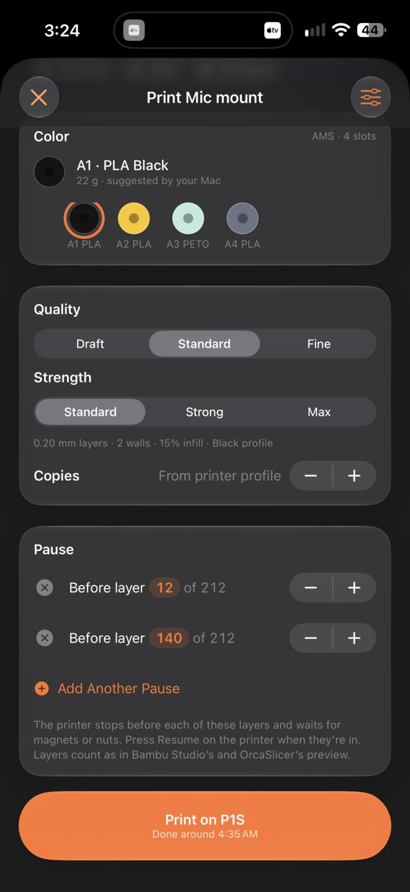
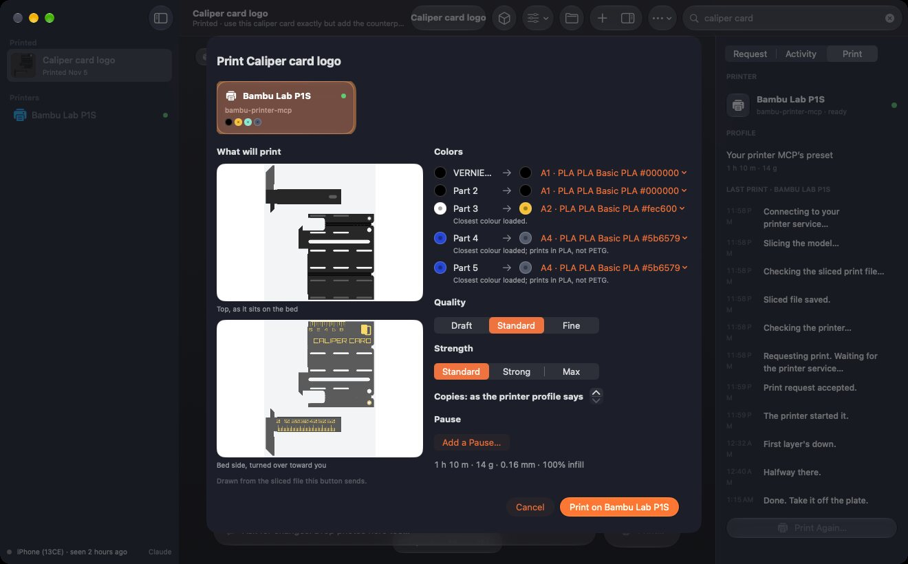

<p align="center"></p>

# Counterpart

**Make the part that fits.** Scan it, describe it, or paste a link. Counterpart makes the part on your own Mac or Linux
computer, shows it to you on your iPhone, iPad or Android phone, and prints it through your printer's own MCP. Docs and
Help: https://counterpart.dtmont.com/

<p align="center">
  
  
</p>

The app was called Scan to Make; internal identifiers (bundle ids, folders such as `~/Library/Application Support/Scan to
Make`) keep the old name.

## How it fits together

| Part | What it does | Where |
|---|---|---|
| **iPhone and iPad app** | Projects, the request (words, photos, LiDAR scans, links), questions from the Mac, checking the model in 3D and AR, printing, Live Activity and widgets. Own layouts for iPad and iPhone Duo. iOS 27. | [`apps/mobile/`](apps/mobile/) |
| **Mac app** | Menu bar extra and main window: projects, the Print sheet, Settings (printers, AI, phones, notifications). Runs the companion. macOS 27. | [`apps/mac/`](apps/mac/) |
| **Companion** | The Mac's service: pairing, the phone's HTTPS API, projects and passes (Claude Code with Blender, or Fusion), events, printing through the printer MCPs. | [`services/companion/`](services/companion/), [`services/project/`](services/project/) |
| **Printer handoff** | Lays flat, slices, inspects and prints through the printer's MCP server, relaying the server's own questions. | [`services/printer-handoff/`](services/printer-handoff/) |
| **Printer MCP servers: the printing backend** | Counterpart has no slicer or printer code of its own; every printer action is a tool call to [bambu-printer-mcp](https://dmontgomery40.github.io/bambu-printer-mcp/) (Bambu Lab) or [mcp-3D-printer-server](https://dmontgomery40.github.io/mcp-3D-printer-server/) (OctoPrint, Klipper, Duet, Repetier, PrusaLink, Creality, Bambu Lab). Fix printer behaviour in the MCP, in both when it applies to both. | [docs](https://dmontgomery40.github.io/bambu-printer-mcp/), [repo](https://github.com/DMontgomery40/bambu-printer-mcp); [docs](https://dmontgomery40.github.io/mcp-3D-printer-server/), [repo](https://github.com/DMontgomery40/mcp-3D-printer-server) |
| **Shared code** | Wire contracts (zod) and the Swift client, models and words both apps use. | [`packages/contracts/`](packages/contracts/), [`packages/CounterpartKit/`](packages/CounterpartKit/) |
| **Scan tools** | USDZ conversion, Blender repair and measurement, close-up-guided correction, Mac reconstruction. | [`tools/`](tools/) |
| **Live Activity relay** | A Cloudflare Worker that signs the print Live Activity's pushes with the app's APNs key. | [`services/relay/`](services/relay/) |
| **Docs site** | counterpart.dtmont.com: the landing page and the Help guide the app links to. | [`site/`](site/) |

**Blender and Autodesk Fusion are optional.** Print an existing model that needs no changes, or reprint a project, without either app. Blender supports scan cleanup and model editing; Fusion supports parametric design and changes. Only workflows that use one of those tools need it installed and set up.

## Docs

- **Product:** the PRD, [`docs/design/overhaul/PRD.md`](docs/design/overhaul/PRD.md), with a mockup of every screen in
  [`docs/design/overhaul/screens/`](docs/design/overhaul/screens/); the consumer journey in
  [`docs/design/journey.md`](docs/design/journey.md).
- **Protocols:** the phone's API ([`objects-api.md`](docs/protocols/objects-api.md)), events and notifications
  ([`events.md`](docs/protocols/events.md)), the Mac app's control socket ([`local-control.md`](docs/protocols/local-control.md)),
  settings ([`settings.md`](docs/protocols/settings.md)) and CloudKit ([`cloudkit.md`](docs/protocols/cloudkit.md)).
- **Status:** start with the working PRD, [`docs/design/overhaul/PRD.md`](docs/design/overhaul/PRD.md) (§0), then
  [`docs/status/handoff.md`](docs/status/handoff.md).
- **Brand:** [`docs/brand/`](docs/brand/): the app icon and the mark.

## Checks

The local gate runs the same jobs as CI (hosted runners aren't available):

```sh
/usr/local/bin/python3 scripts/ci_local.py --changed-only --base origin/main
```

The docs site has its own: `node site/check.mjs`.

## Licence

Counterpart is free software: you can redistribute it and/or modify it under the terms of the GNU General Public License, version 3 ([`LICENSE`](LICENSE)). The printer software it works with, [bambu-printer-mcp](https://github.com/DMontgomery40/bambu-printer-mcp) and [mcp-3D-printer-server](https://github.com/DMontgomery40/mcp-3D-printer-server), is GPL-2.0. Third-party components keep their own licences (`THIRD_PARTY_NOTICES` and the app's About screen).
