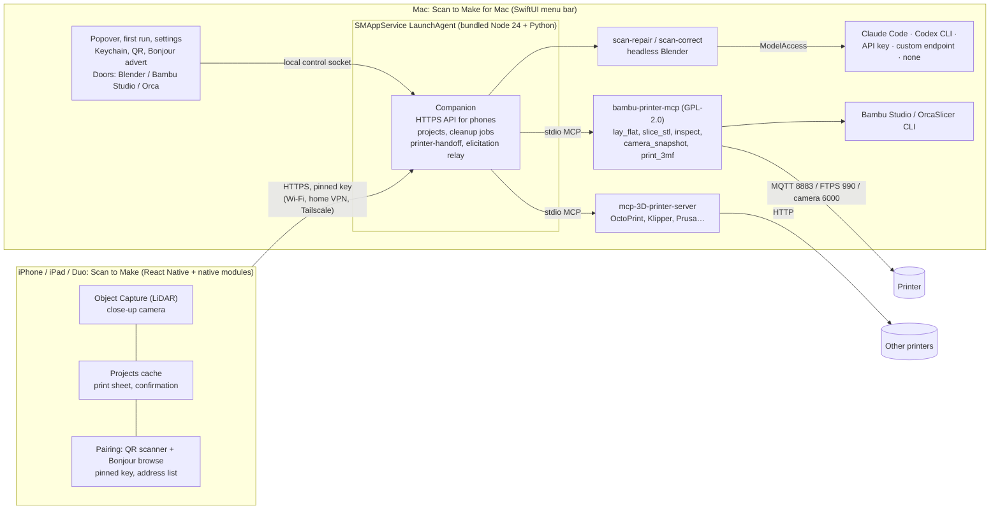

# Scan to Make: the consumer journey

> **Superseded in part (2026-11-01).** [overhaul/PRD.md](overhaul/PRD.md) replaces the screen specs in §5–§9. The decisions in §3 (pairing, the companion, model sign-in) still stand unless the PRD changes them.

From "open the app" to "part on the print bed", on iPhone, iPhone Duo, iPad and the Mac.

2026-10-31. Scope is the accepted 2026-10-31 decision: LiDAR scan + defect cleanup + hand-off to bambu-printer-mcp or mcp-3D-printer-server, selectable from the start. That decision supersedes D002 and the template/design scope. Mockups are in [`mockups/`](mockups/); open [`mockups/index.html`](mockups/index.html).

## Contents

1. [The product in one paragraph](#1-the-product-in-one-paragraph)
2. [The journey](#2-the-journey)
3. [Decisions](#3-decisions)
4. [Who runs what, where](#4-who-runs-what-where)
5. [Screen-by-screen spec: phone](#5-screen-by-screen-spec-phone)
6. [Screen-by-screen spec: iPhone Duo and iPad](#6-screen-by-screen-spec-iphone-duo-and-ipad)
7. [Screen-by-screen spec: Mac](#7-screen-by-screen-spec-mac)
8. [States and failures, in plain words](#8-states-and-failures-in-plain-words)
9. [Words we use, words we don't](#9-words-we-use-words-we-dont)
10. [Cuts](#10-cuts)
11. [Open questions for David](#11-open-questions-for-david)
12. [Tickets](#12-tickets)
13. [Changes from review](#13-changes-from-review)
14. [Sources](#14-sources)

---

## 1. The product in one paragraph

You point your iPhone at a thing. A minute later it's on your Mac, which quietly fills the gaps the camera missed, matches the details to your photos, gets the size right and makes it ready to print. You get a notification. You tap **Print**, see a photo of your printer's empty bed, tap **Start print**, and walk away. That's the whole product for most people.

There are two apps. **Scan to Make** on the iPhone or iPad does the scanning, shows your projects and has the Print button. **Scan to Make for Mac** lives in the menu bar and does the heavy work: cleanup, Blender, AI, slicing and talking to the printer through bambu-printer-mcp. People who want to tweak can open the model in Blender or the print in Bambu Studio or OrcaSlicer with one click. Nobody else ever sees those apps.

## 2. The journey

| # | Where | The user does | The product does |
|---|---|---|---|
| 1 | Mac + iPhone | Downloads Scan to Make for Mac and opens it. The window is a QR code and nothing else. Scans it with the iPhone Camera; the iPhone app opens. | Pairs, and starts fetching Blender and the printer tools in the background. If the phone is on the same Wi-Fi, it can also just find the Mac and ask "Pair with David's Mac mini?". |
| 2 | Mac | Once the phone is connected, the same window asks two questions. First: picks their printer from a list and types the access code shown on the printer's screen. | Finds Bambu printers on the network, checks the connection, shows a live camera photo ("Here's what your printer sees"). |
| 3 | Mac | Second: chooses how AI cleanup signs in (or skips it). | Stores the choice in the Keychain. Cleanup still works without AI. |
| 4 | iPhone | Taps **Scan something** and walks around the object. | Object Capture with our guidance; the scan uploads to the Mac by itself as soon as it ends. |
| 5 | iPhone | Names it (prefilled), optionally takes close-ups while the object is still there. | The Mac starts cleanup immediately. No "check" button. |
| 6 | iPhone (later) | Gets "AirPods Pro 2 case is ready to print". Opens it. | Shows the cleaned model, its size, and one question if the size needs it. |
| 7 | iPhone | Taps **Print**. | Mac lays it flat, slices it for the exact printer, reads the filament, takes a camera photo. |
| 8 | iPhone | Looks at the bed photo and taps **Start print**. | That tap answers bambu-printer-mcp's own confirmation. The printer starts. |
| 9 | iPhone | Glances at progress or leaves. | Live progress and camera; **Stop** is always there. "Done. Take it off the bed." |

The power-user branch hangs off steps 7–8. **Open in Blender** and **Open in Bambu Studio / OrcaSlicer** live on the Mac, or under ••• on the phone, where they tell the Mac to open them.

## 3. Decisions

Each one is a recommendation with a reason, plus what is already decided elsewhere. "Decided" means a PRD section, an accepted decision, or David's words.

### 3.1 The Mac app is required in v1, and it lives in the menu bar

**Recommendation.** Ship **Scan to Make for Mac** as a menu-bar app: a status icon, a popover, a first-run window and a settings window. It replaces `deploy/companion/install-macos.sh` for everyone except self-hosters.

**Why.** Every step after the scan (cleanup, Blender, the AI step, slicing, the printer connection) already runs on the Mac. Today none of it has a face: the QR exists only in a terminal or on a loopback page (#133), printer credentials are hand-edited into `companion.env`, and correction and printer hand-off need hand-written env files and JSON before they work at all. A Mac app turns those into four screens.

**Already decided.**
- PRD WP5: the bridge is "packaged as Docker, HA add-on and **tray app**".
- PRD §9.2 R-Bridge: "a macOS/Windows tray app".
- The research PRD, §14: "Docker alone is not a consumer setup experience".
- The fit-first plan: "The companion is the v1 product, stated plainly. A signed desktop installer (macOS first…) pairs over QR".

Docker and the Home Assistant add-on stay as the self-host shapes.

### 3.2 Native Swift and SwiftUI, not Tauri or Electron

**Recommendation.**
- **App:** SwiftUI `MenuBarExtra` (window style) with `LSUIElement`, so there's no Dock icon. Launch at login through `SMAppService.mainApp`.
- **Companion:** stays the existing Node service. Run it with a bundled Node 24 and register it as an `SMAppService.agent` from inside the app bundle (`Contents/Library/LaunchAgents`). The hand-written `~/Library/LaunchAgents` plist goes away.
- **Updates:** Sparkle 2 with EdDSA signing.
- **Distribution:** Developer ID signing, Hardened Runtime (with `allow-jit` on the embedded Node) and notarization.
- **Secrets:** Keychain for everything secret.

**Why.**
1. **Local Network privacy.** On macOS 15+ a launchd *agent* is not exempt from the Local Network prompt. Only daemons, root processes and things started from Terminal or SSH are. The prompt is attributed to the app that spawned the process. Today's bare Node LaunchAgent has no app bundle to attribute it to, so the companion can silently lose access to the printer. Under SMAppService the app is the responsible code, and the user sees one correctly named prompt. (TN3179: "The exception for launchd daemons doesn't apply to launchd agents.") This also explains a team-wide blind spot: everything tested over `ssh mac` is exempt, so it "worked" there.
2. **The APIs it needs are native.** MenuBarExtra, SMAppService, Keychain, Bonjour advertising (`NWListener`), QR rendering (CoreImage) and FSEvents are all Swift. Tauri would need a Swift bridge for each of them.
3. **Size.** A few MB, against roughly 180 MB for Electron.
4. **No web UI to reuse.** The phone app is React Native, not web, so a web stack has nothing to share.

Tauri is the fallback if the team insists on TypeScript UI. Electron is not.

### 3.3 What the Mac app manages

| Piece | How | Why this way |
|---|---|---|
| Companion (`services/companion`) | Bundled Node 24 and a standalone Python (python-build-standalone) for `capture-mesh-convert` and `scan-correct`. Run as an SMAppService agent. | Removes the Homebrew/Node-exactly-24 requirement that breaks `install-macos.sh` for normal people. |
| bambu-printer-mcp | Pinned npm version (the companion already pins `1.1.42`), installed into `~/Library/Application Support/Scan to Make/` on first run, integrity-checked, spawned over stdio by `services/printer-handoff`. | It stays GPL-2.0 in a separate process, as PRD §10.2 L03 says. It updates with its own releases. We call it; we don't copy it. |
| mcp-3D-printer-server | Same, installed only when the user adds a non-Bambu printer. | Other brands, from the start (scope decision). |
| Blender | Use `/Applications/Blender.app` when its version is supported; otherwise download the pinned build into Application Support with the existing SHA-256 check (`deploy/companion/download-blender.sh`). About 300 MB for the pinned 5.0.1, with progress shown in the first-run window. | Downloading from blender.org avoids redistributing GPL Blender. Today's installer hard-fails on any Blender that isn't 5.0.1; accept a tested range instead. |
| Slicer | Detect Bambu Studio (preferred; its CLI is verified on P1S) or upstream OrcaSlicer. Set `SLICER_TYPE` and `SLICER_PATH` explicitly. If neither is installed, show **Get Bambu Studio**, which opens Bambu's download page. Never the FULU CLI. | FULU v1.0.0's CLI segfaults on every run (FULU.md). mcp-3D-printer-server defaults to FULU when unset, so leaving it unset is a trap. |
| ffmpeg | Downloaded on demand only for printers whose camera is RTSP (X1, P2S, H2 family, X2D). | bambu-printer-mcp needs it for those cameras; P1S and A1 don't. |
| Model access | §3.6. Secrets in the Keychain; the companion gets a reference, never a raw key in an env file. | — |

**Install.**
1. Download a DMG and drag the app to Applications.
2. Open it. The first-run window appears.

There's no Terminal step, no git clone, no admin password and no Full Disk Access. Projects and scans live in `~/Library/Application Support/Scan to Make/` with a visible `~/Scan to Make/` folder for **Show in Finder**.

**Permissions the user sees, and when:**

| Permission | When | Our words before the system prompt |
|---|---|---|
| Local Network | When the app first looks for printers. | "Scan to Make needs to talk to your printer and your iPhone over your home network." |
| Notifications | Optional, the first time a cleanup finishes. | "Get a heads-up when cleanup finishes or a print is done." |
| Open at login | On by default; the switch is in Settings → General, not in first run. | "Keep Scan to Make running in the menu bar." |

**Updates.** Sparkle checks daily. An update never restarts the companion while a cleanup or a print is running; it waits. The MCP version bumps ship inside app updates with a one-line note.

**Readiness.** First run never ends on a half-working Mac. The first-run rail keeps a **Getting ready** list:
- Blender;
- the slicer (with its printer profiles);
- printer support (bambu-printer-mcp, plus mcp-3D-printer-server when needed);
- ffmpeg, when the printer needs it.

Each item shows *Ready*, *Downloading 212 of 304 MB*, *Needs Bambu Studio*, with **Install**, or *Failed* with **Try again**. Downloads resume. The popover keeps an amber "Not ready to print: Bambu Studio is missing" row until it's fixed.

Printer setup has **Set up a printer later**. Pairing and scanning work before any printer exists; Print then says "Add a printer on your Mac first."

**Sleep.** While a cleanup runs or a print is being watched, the app holds a "prevent idle sleep" assertion. The popover says "Your Mac stays awake while it's working". The Mac still has to be on.

### 3.4 Pairing with no terminal: QR first, and nearby discovery as a shortcut

David asked for QR pairing directly (2026-10-31): everything else pairs by scanning a code, and so should this.

**Hard requirement (David, 2026-10-31, after seeing the first mockups): "why is there not just a fucking qr code and nothing else".**
- The Mac's pairing window is the QR code and nothing else: no title, no instructions, no steps, no fields, no toggles, no buttons beyond the window's own traffic lights.
- The Mac app opens on it at first launch, and **Add a phone…** opens the same window.
- Anything else the Mac needs to ask (printer, AI) comes after a phone is connected.
- A QR-only window is already built in the Mac app's open PR (#143, KAN-157/158).

**Recommendation.**
1. **QR is the main path.** The Mac's first window is the QR code alone, and **Add a phone…** in the popover opens the same window any time. It is a `scantomake://pair` link, so the iPhone Camera app opens Scan to Make directly. The link carries:
   - a one-time code (5 minutes);
   - the Mac's public-key fingerprint;
   - **every address the Mac can be reached at**: its LAN IPs, `<name>.local`, and its Tailscale address and MagicDNS name if Tailscale is running.
2. **Nearby discovery is the shortcut.** The Mac advertises `_scantomake._tcp` over Bonjour. On first launch the phone looks for it. If it finds a Mac, it offers **Pair with David's Mac mini**.
   - Both screens then show the same 6-digit code, and the user clicks **Allow** on the Mac.
   - Each side computes the code independently, as a truncated hash of the Mac's long-term public key, the phone's fresh key and a session nonce. The phone commits to its key before the Mac reveals its nonce.
   - Anything in the Bonjour advert (name, fingerprint) is only a hint, because anyone on the Wi-Fi can advertise `_scantomake._tcp`. The matching code is the proof.
   - **Allow** binds only that session, and the existing attempt limit (`remote-auth.ts:436-438`) applies.
   - **Allow** appears as a card in the menu-bar popover. The QR window itself stays QR-only.
   - The phone's pairing screen is a QR scanner, with the nearby Mac shown as a card underneath. Both paths end at the same device credential.
3. **There is no Tailscale question.** After pairing, the phone stores every address and simply tries them in order: Bonjour on the same Wi-Fi, then the last known LAN IP, then the Tailscale address. This covers the case David couldn't find a button for:
   - "I'm already on my home network through Firewalla/WireGuard" works automatically, because the QR carries the LAN IP and the VPN routes to it.
   - Bonjour can't cross a VPN (TN3179: a local network is "Wi-Fi and Ethernet, but not cellular (WWAN) or VPN"). That is why the QR carries addresses.
   - Tailscale shows up only under **Advanced** on the Mac, as a read-out of the addresses in use.
4. **Pin the key, not the IP.** The Mac app creates one long-lived identity (key in the Keychain) and the phone pins its public key (SPKI). A DHCP change then breaks nothing. #133 pins one IP and a 365-day certificate, which breaks on a new IP or after a year.
5. **Credentials refresh by themselves.** Device tokens roll forward on use, and `POST /v1/auth/refresh` extends them (#147, `server.ts:176-183`); the phone still needs a small change to call it. Phones are listed in the Mac's **Devices** settings with **Remove**.
6. **Auth v2 is built** (#147, KAN-161). Device identity no longer depends on the transport. The `version: 1` auth store migrates to `version: 2` in place (`remote-auth.ts:82`, `:117`). Pairing mints the phone's scopes by default, including `printer-handoff:use` (`PHONE_SCOPES`, `remote-auth.ts:393`). "One credential, many addresses" now only needs the v2 payload (BE-5).
   - The v1 payload works end to end today. Main's phone parser accepts #133's optional `f=` certificate pin (`apps/mobile/src/companion/pairingLink.ts`), and a contract test proves it. It still rejects unknown keys, so v2 parsing must ignore unknown keys within a known version for the address list to grow.

**Installing from the QR.** If the iPhone app isn't installed, the QR goes through a universal link to the App Store. That needs a web origin that can serve Apple's `/.well-known/apple-app-site-association` (see open question 1); until then the QR opens the app only when it's installed.
- After installing, the app opens on Find your Mac and says "Scan the code on your Mac again." The first code may have expired.
- The Mac shows a fresh code every 5 minutes while the QR step or **Add a phone** is open, so the code on screen is always valid.

**Permissions can be denied.**
- Camera or Local Network denied on the phone: Find your Mac shows "Scan to Make can't use the camera" / "…can't look on your Wi-Fi", with **Open Settings**. The other pairing path stays available.
- Pairing requests appear as a persistent **Waiting to pair: David's iPhone · 482 913 · Allow** card in the popover, not only as a notification. Notifications are optional and can be silenced.

**Remote use.**
- **v1:** away from home, the phone reaches the Mac through whatever VPN the user already has (Tailscale, WireGuard, Firewalla), with no setup on our side.
- **Without a VPN:** scans wait on the phone ("We'll send it to your Mac when you're home") and project status shows "last seen at 6:12 pm". The fit-first plan says it the same way: "Gateway-absent is a first-class state".
- **Later:** the PRD's relay is the planned default for remote use. §5.1 rejects Tailscale as the *default* because "iOS allows one active VPN configuration at a time" and the free plan is non-commercial. The relay costs money to host, so it is open question 3.

**Already decided.**
- PRD X07: "one QR with the bridge's public key and a 5-minute nonce (est.), confirmed fingerprint, revocable device credentials".
- NET-001 (team vote, 2026-10-14): per-phone pairing and revocation, no Funnel.
- #133 and #134 built the LAN, VPN and pinned-certificate parts. This design extends their payload; it doesn't replace them.

### 3.5 After the scan: one path, and cleanup starts by itself

**Recommendation.** The phone has a single forward path: **Scan something → scan → name → (close-ups) → Ready → Print → Start print**.
- The upload starts the moment the scan ends.
- The Mac starts the one-job cleanup pipeline (#128) on arrival (#144, KAN-170).
- Nobody presses "Check my scan".

On 2026-10-31 the owner's first real scans never got a cleanup job, because today that button sits two screens deep.

**Cleanup never smooths what the scanner actually captured** (KAN-176). On 2026-10-31 a heuristic denoise melted real crochet stitches on a test object and was reverted (#140). Cleanup does four things:

1. **Fill the gaps.** Only where the scan saw nothing: holes and the unseen underside. Only filled faces, their rim and isolated single-vertex outliers move (scan-repair since #142).
2. **Match your photos (AI, optional; KAN-183).** The prompt is David's sentence, verbatim and alone: "Look at the pictures of this, and then tweak the scan based on that." The run happens in a **sealed workspace**:
   - it holds only a copy of the scan and the photos; the originals stay read-only and are hash-checked afterwards;
   - it uses the user's own Claude Code or Codex login;
   - there is no repo, memory, rules, hooks or MCP, and nothing else in the prompt.
3. **Pick the closest (KAN-184).** Best-of-N:
   - two or three runs side by side;
   - each result is rendered with the captured scan from the same fixed cameras, and a sealed judge compares them with the photos under blind labels;
   - if no run is closer than the scan as captured, the captured scan is kept;
   - never a metrics-only gate. In the 2026-10-31 test, results varied a lot from run to run, and one of each tool's two runs damaged something.
4. **Make it printable (KAN-185).** A deterministic step: fuse separate shells and make it watertight. Scale and the captured surface stay untouched.

Then measure and render. In the test, the best run (sealed Codex) came out closer to the real object than the raw scan. The card lettering, the eyes and the dark back matched the photos, and nothing captured was damaged.

**What the Mac does, in the words the phone shows:**

| Pipeline stage | Phone label | Typical |
|---|---|---|
| import | Getting your scan | seconds |
| repair (gaps and underside only) | Filling the gaps | under a minute |
| AI tries + visual pick (AI on) | Matching your photos | 10–20 min, tries run side by side |
| make printable | Making it printable | under a minute |
| measure, render | Measuring | seconds |

The **advise** stage now only suggests photos to take ("a photo of the hinge would help"). It never changes the model.

**Power-user door.** Project ••• → **Compare versions** shows the scan as captured, each AI try and the one picked, side by side, and **Use this one** switches.

With AI off, cleanup fills the gaps and makes the model printable, and everything else stays exactly as scanned. The phone hides "Matching your photos". #128's stage contract (`correct` must produce `corrected.stl`) changes with KAN-183. Estimates need per-stage timestamps on the job record, which don't exist yet (BE-2).

The phone shows one line, "Cleaning up · about 15 min", with a thin progress bar. Tapping it shows the stage list above. Times come from the Mac's own estimate; never show a fake countdown. **Late photos.** Photos that arrive after matching has started queue one more round of tries with all the photos. The status reads "Updating with your photos". The newest finished result always wins; an older job can never replace a newer model. (BE-2.)

When **advise** suggests photos, they appear *while matching keeps running* (#128 publishes `advice.json` early), so the user can still take those close-ups.

### 3.6 Model sign-in: on the Mac, honest about the terms

David asked whether we should wrap CLIProxyAPI so every subscription looks like an API key. Here is what I found, plainly:

- **CLIProxyAPI** is MIT-licensed (`router-for-me/CLIProxyAPI`), actively maintained (v8.0.48 on 2026-10-30) and embeddable as a Go library. **Technically we can wrap it.**
- **Anthropic forbids doing that with a Claude subscription.**
  - Claude Code legal page: "Anthropic does not permit third-party developers to offer Claude.ai login into their own applications, or to route requests through Free, Pro, Max, or Ultra plan credentials on behalf of their users. Moreover, developers may not collect, store, or intermediate Claude.ai credentials or session tokens — sign-in to a Claude account must complete through Anthropic's own flow."
  - Enforcement has happened in 2026, "without prior notice".
- **Google forbids it for Gemini.** Gemini CLI terms: "using third-party software… with Gemini CLI OAuth is a violation… may be grounds for suspension or termination of your account". Bans have happened.
- **OpenAI tolerates it, and also has a sanctioned path.** OpenAI tolerates third-party tools using a ChatGPT plan, but that isn't contractual. The sanctioned route is **Sign in with ChatGPT**: OIDC, and "ChatGPT plan usage is available to all open-source partners".
- **What *is* allowed for Claude:** the user's own, unmodified Claude Code, signed in through Anthropic's own flow. Anthropic's page says a product may run Claude Code if "each end user… authenticate[s] with their own… Claude subscription plan credentials", under Anthropic's Commercial Terms.

**Recommendation.** One **AI cleanup** card in the Mac app, with these choices in this order.
- The first two are the **primary path** (KAN-183): the cleanup agent *is* the user's own Claude Code or Codex, run in the sealed workspace with David's sentence (§3.5).
- Best-of-N uses the plan's allowance two or three times per scan, and the card says so.

1. **Use my Claude subscription.** It uses the user's own Claude Code; if it isn't installed, the app offers Anthropic's official installer. Sign-in happens in Anthropic's own window. The cleanup agent runs as `claude -p` in the sealed workspace, with only the scan, the photos and the sentence. This needs David to accept Anthropic's Commercial Terms for Scan to Make (open question 2).
2. **Use my ChatGPT plan.** Sign in with ChatGPT as an open-source partner. Until the client ID arrives, it uses the user's own Codex CLI (`codex exec`) the same way.
3. **Use an API key.** Anthropic, OpenAI, Google or OpenRouter. Stored in the Keychain. The same sentence and photos go through scan-correct's adapters (`tools/scan-correct/adapters.py`), with the same best-of-N and visual pick.
4. **Advanced → Custom endpoint.** Any OpenAI-compatible URL: a local proxy such as CLIProxyAPI, Ollama or LM Studio. The adapter already allows `http://127.0.0.1` (`adapters.py:56-62`). We don't ship the proxy and we don't touch its credentials. What a power user points it at is their call.
   - Choices 1 and 2 still carry conditions:
     - Claude Code: the binary is unmodified, each user signs in with their own credentials, and Anthropic's Commercial Terms apply.
     - Sign in with ChatGPT: open-source partner eligibility and a client ID.
5. **Skip.** Cleanup runs without AI: it fills the gaps, makes the model printable and checks the size, and the captured surface stays exactly as scanned. Photo matching is off, and the popover says so once.

**Every choice ends in a verified state, not a click.**
- The card shows **Connected · Claude (your subscription)** only after a tiny test call succeeds.
- Otherwise it shows what's wrong, in words:
  - "Claude Code isn't installed" with **Install**;
  - "Finish signing in in the Anthropic window" while sign-in is pending;
  - "Sign-in expired" with **Sign in again**;
  - "You've hit your plan's limit for now; cleanup will finish without AI";
  - "That key didn't work".
- The custom endpoint asks for address, model and key.
- Every failure offers **Continue without AI**. Cleanup never stalls on AI.

**Naming.** Anthropic's page lets us say in plain text that the app runs Claude Code. It doesn't let us use the Claude Code or Anthropic names or logos in our own feature names or icons. So the row is a plain description ("Use my Claude subscription · Uses Claude Code on this Mac"), with our own icon and no Anthropic logo.

**The abstraction.** The companion sees one `ModelAccess` setting: `claude-code | codex-cli | api(provider, model, keychainRef) | endpoint(url, model, keychainRef) | none`. `none` skips the AI step.
- The Mac app reads the secret from the Keychain and injects it into the cleanup worker's environment when it spawns it, over the control socket. scan-correct reads keys from an env var (`adapters.py:93`) and needs an explicit model for OpenAI-style calls (`adapters.py:91`).
- The two CLI kinds are the primary path (KAN-183). Each run gets a fresh sealed workspace:
  - a copy of the scan and photos; the originals stay read-only and are hash-checked afterwards (in the test, one tool overwrote its inputs in place);
  - a clean config home holding only the login and model settings;
  - no repo, memory, rules, hooks or MCP.
- The correction sandbox's network ban gets a scoped exception for the CLI's own connection to its provider. Keys and tokens never leave the Mac, never go in `companion.env`, and never reach the phone. This is the "abstract it away" David asked for, on routes that won't get his users' accounts banned.

**Already decided.** The PRD home-bridge shape is "bring-your-own model key or a local model" (PRD §5). No accepted decision covers subscriptions; KAN-104 was closed during the scope rewrite.

### 3.7 The print button

**Recommendation.** On the phone, **Print** opens a sheet; on the Mac, it is one call chain into bambu-printer-mcp.

**On the Mac, through the existing `services/printer-handoff`:**
1. `lay_flat`, or the slicer's own `orient` for rounded scans, because `lay_flat` "may be unpredictable" on organic shapes (bambu README).
2. `slice_stl` with Bambu Studio and the exact machine preset.
3. `inspect_print_file`.
4. `get_printer_filaments` for the colour choices.
5. `camera_snapshot`.
6. `print_3mf` with `ams_slots`.

The Print sheet shows what the slice returned: a picture of how it sits on the plate, the printer, the colour (from the AMS), print time and grams.

**The confirmation.** bambu-printer-mcp asks its own question, a form with one boolean, "I checked the printer and confirm this operation" (`src/index.ts:1225-1232`). When the pending question's schema is **exactly** that one required boolean, the phone shows it as:
- the camera photo, large;
- the MCP's own message, **verbatim**, laid out one line per sentence (printer model, nozzle, material, "build plate is clear", plus any physical-check notes it adds after a finished job). The relay carries the message as free text, next to the form schema and the snapshot (`elicitation.ts:19-23`), so we lay the message out but never rewrite it;
- one button: **The bed is clear — Start print**.

Any other question, such as the model picker (`index.ts:1278`) or a hardware-error confirmation, uses the generic form renderer from #132, with the same photo on top.

The photo **stays fresh while the screen is open**. It refreshes every few seconds, shows its real age ("Updated 3 s ago"), and carries a small **Refresh** button for when a refresh fails.

The camera check **fails closed**:
- On a camera-capable route with no snapshot, or a snapshot older than about 30 seconds, the phone shows "Can't see the bed right now. Check the printer, then try again." and no Start button.
- Today the snapshot is taken before `print_3mf`'s own checks and failures are swallowed (`print.ts:176-189`); BE-4 changes that.

That tap *is* the MCP's confirmation. There's no separate checkbox and no second approval screen. David, 2026-10-25, on checking the bed before a print: "that is what the camera check is for." So the photo and this one button are the whole approval. #132's required "I checked the printer…" checkbox therefore becomes the button itself. If the MCP's 10-minute wait runs out, the phone says "You didn't answer in time, so nothing printed."

**Route.** Set once at printer setup on the Mac, never at print time.
- The choices come from the detected model and firmware, not one fixed list:
  - X2D gets bambu-printer-mcp's native route (`bambu_native`);
  - printers on firmware that accepts LAN commands without Developer Mode skip the question.
- The copy says "Requires changing settings on your printer". Selecting an option never changes the printer itself.

For a P1S/A1/X1/H2 on current firmware the setup screen asks one question:

| Choice shown | Route | What the user gives up | When |
|---|---|---|---|
| **Print from your phone** (recommended) | Direct LAN: `print_3mf` `lan_mqtt_ftps` with LAN Only + Developer Mode | Bambu Handy and Bambu Cloud stop working while it's on. Scan to Make shows the camera and progress instead. | Most people. A guided walkthrough with the printer-screen photos from bambu-printer-mcp SETUP.md. |
| **Keep Bambu Handy** | Bambu Connect hand-off: `bambu_connect_import_file` | Pressing Print happens on the Mac, in Bambu Connect. The phone says "Finish on your Mac: press Print in Bambu Connect." | People who won't change printer settings. |
| Advanced: **FULU bridge** | `print_3mf` `connection_mode: bambu_network`, LAN | Nothing. Bambu's plug-in signs the command, so there's no Developer Mode and the cloud stays on. | Offered only when `bambu_network_bridge_status` finds a working runtime. On macOS FULU still needs a Linux VM ("macOS a work in progress", FULU.md), so it isn't a consumer default yet. |

**Save for SD card** (PRD R-Stick) is always under ••• and works on every firmware.

**Queued prints.** "Print when it's ready" (cleanup still running) and "Print when it's free" (printer busy) put the project in a **Queued** state:
- the card shows "Queued · we'll ask you to check the bed", with **Cancel**;
- when it's time, a notification ("Ready to print AirPods Pro 2 case: check the bed") opens straight onto the confirmation;
- nothing ever starts without that tap.

**Other brands.** **Add printer → Other brand** offers OctoPrint, Klipper (Moonraker), Prusa, Creality, Duet or Repetier. The user enters an address and API key, and the app runs mcp-3D-printer-server's `get_printer_status` as the check. Prints use `upload_gcode` with `print:true`. Those printers have no camera tool, so the confirmation shows the server's message and "No camera on this printer. Check the bed yourself." with the same single button. That is the one case where Start appears without a photo. Preparation, progress and stop come from that backend's capabilities (BE-4): for example `upload_gcode` with `print:true`, status polling through `get_printer_status`, and `cancel_print`, which mcp-3D-printer-server has. It has no pause. The phone never says "MCP"; the printer you pick decides which server runs.

**Already decided.**
- bambu-printer-mcp is the printing and slicing back end (#decisions, 2026-10-30).
- PRD §9.2 routes.
- AGENTS.md: "Starting a physical print keeps bambu-printer-mcp's own human confirmation."

### 3.8 Power-user doors

**Recommendation.** They are real desktop apps, so there's no iframe: launch the real app with the file, then pick the result back up.

- **Open in Blender** (Mac popover row, or the project's ••• on the phone, which tells the Mac to do it):
  1. The Mac opens Blender with the cleaned model already imported (`Blender --python <import script>`). The script adds a **Send back to Scan to Make** button in the sidebar.
  2. The app watches the project folder for saves. Watch the directory, because Blender saves by renaming a temp file.
  3. On a save, the Mac and phone ask: "You changed *AirPods Pro 2 case* in Blender. Print your version?" **Use my version** / **Keep the cleaned one**.
  4. "Your version" becomes the model that prints. The cleaned one stays one tap away.
- **Open in Bambu Studio / Open in OrcaSlicer:**
  1. Opens the sliced `.3mf` from `slice_stl` with `open -a`.
  2. If the user prints from there, we're done and say nothing.
  3. If they save the 3MF, the app asks "Print with your Bambu Studio settings?" and sends *that* file through `print_3mf`, which inspects it again.
- **Show in Finder:** the project folder holds the original scan, the cleaned model (STL and OBJ), the close-ups and the cleanup report. This is where file formats live, never on the phone.

On the phone these doors sit under ••• → **Edit on your Mac** and are labelled with the Mac's name. After a tap the phone says "Opened on David's Mac mini. Come back when you're done." They don't appear anywhere else.

### 3.9 Projects: one object, one card

**The model.** **A project is one object.** It has:

| The user sees | What it is | Notes |
|---|---|---|
| **Name** | `AirPods Pro 2 case` | Asked after the scan, prefilled from on-device image labelling. Editable. |
| **Model** | the cleaned scan, or "your version" after a Blender edit | What prints. One current model. |
| **Size** | `60.6 × 45.2 × 21.7 mm` with a source: *Scanned*, *Maker's size* or *You measured* | See below. |
| **Close-ups** | photos of details | Taken in the app, attached to the project, not to one scan. |
| **Prints** | history: date, printer, colour, result | Read-only. |

Hidden under ••• → **Earlier scans**: re-scanning replaces the current scan, and earlier ones are kept there with **Use this scan**. Project "revisions" stay an internal integrity mechanism. The UI never blocks with "This scan is from an earlier version".

**Projects live on the Mac** as the source of truth and are cached on each phone. Every paired device sees the same projects, which is what makes the iPhone Duo useful: it can print, or add close-ups to, a project scanned on an iPhone Pro. This changes today's model, where projects live on the phone (`LocalProjectStorage`); see ticket BE-1.

**Typed dimensions.** Size is asked **once, after the first cleanup, on the project page**. It is never a three-field form, never during scanning, and never before you have a model to look at. The Size card shows the scanned size and, if needed, one question:

1. **The maker's size, if we recognise the product.** "Is this an *AirPods Pro 2 case*? Apple lists it as 60.6 × 45.2 × 21.7 mm." **Use Apple's size** · **No**.
   - Three known sides allow a small correction **per side**, not one uniform factor. Scan error isn't the same in every direction.
   - Each side may move at most ±5%. On the AirPods scan that is −2.1%, −3.2% and 0%, so the result is exactly 60.6 × 45.2 × 21.7 mm.
   - If any side would need more: "Your scan is too far from Apple's size to fix safely. Scan again, or keep the scanned size."
   - This comes from the AI step, with a source link shown.
   - It matches David's direction that a known product's published size is the ground truth (2026-10-30: "very very publicly known object with well known exact sizing"), and the KAN-96 run that scaled the real scan "to exactly the spec".
2. **One measurement.** "Measured it yourself? Enter one side." A sheet shows a 3D box around the model with three labelled edges: tap the edge you measured, type its length, done.
   - One number can only scale the whole model **evenly**. The sheet shows the result: "Makes it 2.1% smaller · 60.6 × 45.7 × 21.2 mm".
3. **Keep the scanned size**, which is the default. It is fine for most things.

Changing the size never re-runs cleanup. It is applied after the job with bambu-printer-mcp's `scale_stl` (`index.ts:2331`), which takes `scale_x/y/z`, per the AGENTS.md "use what exists" rule.
- The cleaned model is already turned to its box frame by scan-repair (KAN-115), so X/Y/Z are the box edges.
- The scale is per side for the maker's size and even for one measurement.
- It is keyed to the cleaned model's oriented box: Length = longest edge, Width = middle, Height = shortest. Those are stable ids, so "the edge you measured" means something.
- #128's `scale_to_reference` is the wrong tool for this. It fits independent per-axis factors with a hard 0.5–2× limit (`worker.py:127`), and only the `scripted` adapter calls it deterministically. Unlike today, the size **actually changes the model**: today's "real size" only grades the scan (`compareScanDimensions`) and is lost on relaunch.

**Already decided.**
- Team vote, 2026-10-14: "Ruler entry is a low-confidence correction path, never the default" and "Dimensions shown with an uncertainty interval". The Size card shows "± about 2 mm" for *Scanned*.
- PRD W03: every dimension shows its source in plain words.

### 3.10 iPhone Duo, iPad and LiDAR

**Recommendation.**
- **iPhone Duo.** It has no LiDAR, so there is no scan button and no fake capture path (David: "don't fake it if it's not doable without lidar").
  - Home shows a calm one-line card: "This iPhone can't scan: it has no LiDAR. Scan on an iPhone Pro or iPad Pro paired with this Mac and it shows up here."
  - Everything else is first class: projects, close-ups (they don't need LiDAR), Print and progress.
- **Postures:**
  - **Folded (outer panel):** the iPhone layout.
  - **Open:** two panes, the list beside the project.
  - **Half-open (tabletop):** the top half shows the live printer camera or the 3D model, and the bottom half has the controls. This is the best print-watching device we support.
- **iPad Pro** has LiDAR and scans. It uses a sidebar and detail split. Scanning uses the same full-screen flow.
- After pairing, Connected ends on **Scan something** only on LiDAR devices. On a Duo it ends on **Open projects**.
- A Duo with no projects yet shows: "Nothing here yet. Scan something on an iPhone Pro or iPad Pro paired with David's Mac mini; it appears here a minute later."
- Capability is checked at launch, not after a project exists. Today the "needs LiDAR" message appears only inside "Project captures".

**Already decided.** The 2026-10-31 Duo/iPad and LiDAR-required decisions in #decisions.

## 4. Who runs what, where

| Runs on | What | Owner of the code |
|---|---|---|
| Phone | Capture, close-up camera, project cache, 3D viewer, print sheet, confirmation, progress, pairing. **No secrets except its own device credential.** | `apps/mobile` |
| Mac app (Swift) | UI, onboarding, Keychain, QR, Bonjour advertising, pairing approval, supervising the agent, dependency installs, doors, keep-awake, notifications, Sparkle. | new `apps/mac` |
| Companion (Node) | Phone API, projects, cleanup pipeline, printer hand-off, confirmation relay, model access adapter. | `services/companion`, `services/printer-handoff`, `services/project` |
| bambu-printer-mcp / mcp-3D-printer-server | Slicing, mesh edits, safety, camera, every print route, the confirmation itself. | their own repos; called, never copied |
| Hosted (later) | Relay for remote use (PRD §5.1); optional hosted cleanup (#123) for people without a Mac. | not in v1 |

**New contracts:**
- phone ↔ companion: pairing v2 payload, project-on-Mac sync, cleanup job index, print session;
- app ↔ companion: a local control socket, admin only, never on the network.

See §12.

## 5. Screen-by-screen spec: phone

The copy here is the real copy. ⓘ marks the mockup file.

### P1 Projects (home), ⓘ `01-phone-home.html`

- **Top bar:**
  - Mac pill: green dot + "David's Mac mini". Grey dot + "Mac asleep" when it can't be reached. Tapping it opens the Connection sheet (P8).
  - Gear button: Settings (P9).
- **Large title:** "Projects".
- **Grid:** two columns on iPhone. Each card has a dark stage with the model, the name, one status chip and the size.
  - Status chips, exactly one per card:
    - "Ready to print" (green)
    - "Cleaning up", with "About 12 min left" under it (amber, with a thin bar)
    - "Printing · 42%" (clay)
    - "2 close-ups to add" (grey)
    - "Waiting for your Mac" (grey)
    - "Printed" (green check)
  - Size line: "60.6 × 45.2 × 21.7 mm".
- **Floating glass bar:** one clay button, "Scan something".
- **Empty state (paired, no projects):**
  - "Scan your first thing"
  - "Pick something small that fits in your hand. Put it on a table with some space around it."
  - Three steps:
    1. "Walk around it with your iPhone" / "About a minute. LiDAR measures it as you go."
    2. "Your Mac cleans it up" / "Fills the gaps the camera missed. You can put the phone down."
    3. "Print it" / "One button. Your Mac checks the printer first."
- **Not paired:** home is replaced by Find your Mac (P7).

### P2 Scan, ⓘ `02-phone-scan.html`

- Full-screen camera.
- **Top:** ✕ (keeps nothing; asks "Stop scanning? You'll lose this scan." **Stop** / **Keep scanning**) and the pill "LiDAR ready".
- **Ready:**
  - "Point at the object" / "Fit it inside the corners. Leave a hand's width of table around it."
  - The shutter, with "Tap to start".
  - Corner brackets lock onto the object Object Capture detects.
- **Scanning:**
  - Three bars for three passes: "Around the middle", "From higher up", "Flip it over (optional)".
  - "Walk around it slowly" / "Keep the phone about this far away. The ring fills in as you go."
  - The ring around the object fills, green points show what LiDAR has measured, and **Pause** is always visible.
- **Coaching lines,** shown one at a time and only when needed:
  - "Slow down a little"
  - "Too dark. Turn on a light?"
  - "Move back a bit"
  - "Lost it. Point at the object again."
- **Flip prompt:** "Want the bottom too? Flip it over and do one more lap." **Flip and continue** · **Skip, it sits flat**.
- **Finished sheet:**
  - "Scan finished", then the name field prefilled from on-device labelling. Caption: "Name it so you can find it later. We guessed from the photo."
  - Upload row: "Sending to David's Mac mini…" with progress, then "Sent. Cleanup has started."
  - "Cleanup starts as soon as it arrives. You can put your phone down; we'll let you know."
  - Primary: "Add close-ups while it's here". Plain: "Done for now".
- **Offline:** "Saved on your phone. We'll send it to David's Mac mini when it's reachable."

### P3 Close-ups, ⓘ `03-phone-closeups.html`

- **Title:** "Close-ups". Subtitle: "Your Mac matches the scan to these. About a dozen, all the way around, plus anything small."
- **Before the Mac has looked:** generic targets as tappable rows: "Ports and openings", "Buttons and switches", "Edges, lips and hinges".
- **After advise:** "Your Mac would like a closer look at:", then up to 4 rows, each with a thumbnail of the model with the area highlighted, e.g. "The back, by the hinge" · "about a hand's length away". Rows tick off as photos arrive.
- **Camera:**
  - In-app, with no photo picker by default.
  - A target ring and the hint for the current row.
  - The shutter; then **Use photo** / **Retake**.
  - **Photo library** is a small secondary button.
- **Strip** of taken photos at the bottom. Long-press: **Remove**.
- **Footer:** "Done" when ≥1 photo. With AI on, the line "Your Mac will use these to sharpen the details." With AI off: "Saved with the project. Turn on AI cleanup on your Mac to use them."
- Close-ups upload immediately. There's no "Add N photos" step.

### P4 Project, ⓘ `04-phone-project.html`

- **Hero:** a dark stage with the model, rotatable (drag), and a "3D" hint chip.
- **Title:** the name (tap to rename). Under it, a status line:
  - "Cleaning up · about 15 min" with a bar. Tapping expands the stage list (§3.5): ✓ Getting your scan · ✓ Filling the gaps · ● Matching your photos · ○ Making it printable · ○ Measuring.
  - "Ready to print" once done.
- **Size card:**
  - Header "Size", the value "61.9 × 46.7 × 21.7 mm" and its source chip ("Scanned · ± about 2 mm").
  - When a question applies: "Is this an AirPods Pro 2 case? Apple lists it as 60.6 × 45.2 × 21.7 mm." **Use Apple's size** · **No**. The secondary link is "I measured it myself".
- **Close-ups card:** the strip of thumbnails plus "Add". If the Mac asked: "Your Mac would like 2 more close-ups."
- **Primary button (sticky):**
  - "Print" when ready;
  - "Print when it's ready" while cleaning. It queues, the button turns into "Queued · we'll ask you to check the bed" with **Cancel**, and a notification brings you back to the confirmation;
  - disabled "Waiting for your Mac" when there is no connection.
- **••• menu:**
  - Rename
  - Scan again
  - Earlier scans
  - Compare versions (the scan as captured, each AI try, the one picked)
  - Edit on your Mac → Open in Blender / Open in Bambu Studio
  - Save for SD card
  - Share model…
  - Delete project
- **Cleanup failed:** "Cleanup didn't finish. Your scan is safe." **Try again** · **Print the scan as it is**.

### P5 Size sheet, ⓘ `04-phone-project.html` (third phone)

- **Title:** "Measured it yourself?" Subtitle: "Enter one side. We'll size the whole model to match."
- A 3D box around the model with three tappable edge labels: "Length 61.9", "Width 46.7", "Height 21.7". The selected edge is highlighted in clay.
- A field with a mm suffix and the large numeric keypad. Live preview of the even scale and its result: "Makes it 2.1% smaller · 60.6 × 45.7 × 21.2 mm".
- Primary: "Use this size". Plain: "Keep the scanned size".
- Validation: "That's more than twice the scanned size. Check the number?" (soft; can continue).

### P6 Print, ⓘ `05-phone-print.html`

**Print sheet:**
- Plate preview: the model on a textured plate, as sliced.
- Rows:
  - Printer: "Workshop P1S · Ready", with a green dot.
  - Colour: AMS chips from `get_printer_filaments`, e.g. ● Grey PLA (slot 3) selected, ● Black PLA, ● White PLA. With no AMS: "External spool · PLA".
  - Time and material: "1 h 12 min · 18 g".
  - Size: "100% · 60.6 × 45.2 × 21.7 mm", with **Change** opening a stepper.
- Primary: "Print". Secondary text: "Your Mac checks the bed, then prints it."
- While preparing (lay_flat, slice): "Getting it ready to print…" with the steps "Laying it flat", "Slicing for your P1S", "Checking the printer".

**Confirmation** (bambu-printer-mcp's question):
- Title "Is the bed clear?"
- Large camera photo that refreshes while the screen is open, labelled with its real age ("Updated 3 s ago"). A small **Refresh** button on the photo; no Start button without a fresh photo on a camera printer.
- The MCP's message, verbatim, one line per sentence (bambu-printer-mcp `confirmPrintPreflight`; example for a P1S):
  - "Start a checked print on P1S (01P00A…)?"
  - "Nozzles: 0.4 mm. Materials: PLA."
  - "Confirm the physical spool labels and that the build plate is clear."
  - In small type below: "Peak targets: nozzle 220°C, bed 65°C, chamber 0°C. File SHA-256: 3f9a…c21e."
- Primary: "The bed is clear — Start print". Plain: "Not now".
- Footer: "Waiting for you · 9 min left. If you don't answer, nothing prints."
- After a finished job, the MCP's physical-check sentence appears in bold: "The printer reports FINISH: remove the previous part and debris before confirming."

**Printing:**
- Live camera, refreshed every few seconds: "Printing · 42% · 42 min left · layer 61 of 144".
- Big **Stop** (red outline). Its confirmation: "Stop this print? The printer will stop and cool down." **Stop print**.
- Bambu Connect route instead: "Finish on your Mac: press Print in Bambu Connect." and **Done**.

**Done:**
- "Done. Take it off the bed."
- Camera photo of the finished part.
- "How did it come out?" with 👍 / 👎. The answer is saved to the project's Prints.

### P7 Find your Mac (pairing), ⓘ `06-phone-pairing.html`

**First launch, not paired:**
- Title: "Find your Mac".
- Body: "Scan to Make uses your Mac to clean up scans and talk to your printer."
- A live QR viewfinder takes the top half, with the caption "Point at the code in Scan to Make on your Mac".
- **Nearby card,** shown when Bonjour finds a Mac: Mac icon, "David's Mac mini", "On this Wi-Fi", button **Pair**.
- Footer link: "Don't have the Mac app yet?" opens a sheet: "Get Scan to Make for Mac from the Scan to Make website on your Mac. It shows a code to scan." with **Share link**. The download itself is a GitHub release.

**Confirm (Bonjour path):**
- "Pair with David's Mac mini?"
- A large 6-digit code: "482 913".
- "Make sure your Mac shows the same number, then click Allow on your Mac."
- A spinner: "Waiting for your Mac…".

**QR path:** no confirmation step. The QR is the proof. The app goes straight to Connected.

**Connected:**
- Check animation, "Connected to David's Mac mini".
- "Printer: Workshop P1S · AI cleanup: on".
- **Scan something** on LiDAR devices; **Open projects** on an iPhone Duo.
- After a fresh App Store install from the QR: "Scan the code on your Mac again."

**Local Network pre-prompt,** before iOS asks: "To find your Mac, Scan to Make needs to look on your Wi-Fi." **Continue**.

**Errors:**
- Code expired: "That code expired. Show a new one on your Mac: click the Scan to Make icon in the menu bar → Add a phone."
- Not reachable after the QR: "Your phone can't reach David's Mac mini. Are they on the same Wi-Fi, or is your VPN on?" **Try again**.

### P8 Connection sheet (from the Mac pill)

- "David's Mac mini" with "Connected over Wi-Fi", "Connected through your VPN" or "Last seen 6:12 pm".
- "Printer: Workshop P1S · Ready".
- **Pair another Mac** · **Forget this Mac**.
- A footnote in small type: the address in use (power users).

### P9 Settings (phone)

- Your Mac: name, connection, **Forget**.
- Notifications.
- Units: mm / inches.
- About: version and licence. This replaces the separate About screen.
- Help.

## 6. Screen-by-screen spec: iPhone Duo and iPad

ⓘ `07-duo-ipad.html`

- **Duo folded (outer panel, 466 × 678 pt).** The iPhone layout at outer-panel size. The glass bar has no "Scan something". At the top of Projects:

  > **This iPhone can't scan.** It has no LiDAR. Scan on an iPhone Pro or iPad Pro paired with David's Mac mini, and it shows up here.

  It can be dismissed into a small ⓘ in the title row. Project pages keep Print and Close-ups.
- **Duo open (inner panel, 951 × 669 pt, landscape, crease down the middle).** Two panes, split on the crease: the projects list (a single column) on the left half and the project page on the right half. The selected card is outlined in clay. The project hero gets more height.
- **Duo half-open (tabletop).** The top half is the live printer camera, or the 3D model when nothing is printing. The bottom half has status, Stop, and the next action. The fold line falls in the gap between the two cards and never through text.
- **iPad (13").** A sidebar with Projects and a "Scan something" button at the bottom (iPad Pro has LiDAR), and the project page as the detail. Print opens as a centred form sheet. Close-ups and Scan are full-screen.
- **Rule for every size.** The primary button always stays above the keyboard and the home indicator. Text never straddles a hinge.

## 7. Screen-by-screen spec: Mac

### M1 Menu-bar popover, ⓘ `08-mac-menubar.html`

- **Icon:** a monochrome cube glyph. A small clay dot while working; a green dot while printing.
- **Header:** "Scan to Make", status "Ready" / "Working on Cabinet knob" / "Printing GoPro mount".
- **Now** section, one card per active thing:
  - Cleanup: "Cabinet knob · Matching your photos · about 12 min" with a bar.
  - Print: camera thumbnail, "GoPro mount · 42% · 38 min left", **Stop**.
  - Waiting for an answer: "The printer is waiting for you. Answer on your iPhone, or **Check here**". The Mac can answer the same confirmation, with the same photo and button.
- **Projects** section: the last 5. Each row has a thumbnail, name and status. On hover the row shows icon buttons for **Open in Blender**, **Open in Bambu Studio** and **Show in Finder**, plus ••• (Open in OrcaSlicer, Print, Delete).
- **Printer:** "Workshop P1S · Idle · Grey PLA, Black PLA, White PLA".
- **Footer:** **All projects…** · **Add a phone…** (opens the QR-only window) · **Settings…** · **Quit**.
- **"Use your version?" banner,** after a Blender save: "You changed AirPods Pro 2 case in Blender." **Use my version** · **Keep the cleaned one**.
- **Pair request:** a persistent card at the top of the popover, "David's iPhone wants to connect · 482 913", with **Allow** · **Don't Allow**. A notification says the same thing if notifications are on.
- **All projects…** opens a small searchable window of every project, with the same doors. The popover stays about what's happening now.
- **Not ready to print** row (amber) while a required app is missing: "Bambu Studio is missing" with **Install**.

### M2 First run, ⓘ `09-mac-first-run.html`

1. **The QR window (first launch, and every Add a phone…).**
   - A small white window: the QR code and nothing else (hard requirement, §3.4).
   - No title, no caption, no status line, no buttons. The window's traffic lights are the only chrome.
   - The code renews itself every 5 minutes without any visible countdown.
   - When a phone connects, the window turns into the two questions below. If the user closes it, the app stays in the menu bar and **Add a phone…** reopens it.
2. **Printer** (after a phone is connected). A 720 × 520 window.
   - The left rail lists "Your iPhone ✓ · Printer · AI cleanup".
   - A "Getting ready" list at the bottom of the rail shows each dependency: "Blender 5.0 · 212 of 304 MB", "Bambu Studio · Ready", "Printer support · Ready".
   - "Choose your printer", then the printers found on the network (SSDP), e.g. "Workshop · P1S · 192.168.1.71". Plus **Other brand…** and **Enter address…**.
   - Selecting one asks for "Access code". Hint: "On the printer: Settings → WLAN → Access Code", with the photo from bambu-printer-mcp `docs/images/p1s-network-settings.jpeg`.
   - The check runs `get_printer_status` and `camera_snapshot`, never a print: "Here's what your printer sees", with the photo.
   - Then the route question (§3.7), derived from the detected model:
     - **Print from your phone (recommended):** "Requires changing settings on your printer: LAN Only and Developer Mode. Bambu Handy stops working while they're on; Scan to Make shows the camera and progress instead." **Show me how**.
     - **Keep Bambu Handy:** "You'll press Print in Bambu Connect on this Mac."
   - Footer: **Set up a printer later** · **Back** · **Continue**.
3. **AI cleanup.**
   - "Sharper details with AI (optional)". Body: "AI looks at your photos and tweaks the scan to match. Your scan and photos go to the AI service you pick."
   - Choices:
     - **Use my Claude subscription**, captioned "Uses Claude Code on this Mac. You sign in with Anthropic." It shows "Connected · Claude (your subscription)" only after a test call succeeds.
     - **Use my ChatGPT plan**
     - **Use an API key…**
     - **Skip for now**
   - **Advanced: custom endpoint** sits under a collapsed disclosure.
   - Footer: **Continue without AI** · **Back** · **Continue**. Continue closes the window; the app lives in the menu bar from then on.

### M3 Settings window, ⓘ `09-mac-first-run.html` (last scene)

| Tab | Contents |
|---|---|
| General | Open at login; storage location; keep Mac awake while working; updates |
| Devices | Paired phones (name, last seen, **Remove**); **Add a phone…** |
| Printers | Printers with their route; **Add printer…**; per printer: **Check connection**, **Change how it prints**, **Remove** |
| AI cleanup | The choice from first run; **Change** |
| Apps | Detected Blender, Bambu Studio, OrcaSlicer (version, **Change…**); "Open in" defaults |
| Advanced | Addresses in use (LAN, `.local`, Tailscale); custom model endpoint; **Open logs**; companion version and MCP versions |

## 8. States and failures, in plain words

| Situation | Phone says | Mac says | Action |
|---|---|---|---|
| Mac asleep or off | Pill: "Mac asleep". On scan: "Saved on your phone. We'll send it when David's Mac mini is back." | — | Auto-retry, then a notification when sent |
| Phone away, no VPN | "You're away from home. We'll send it when you're back on your Wi-Fi." | — | Queue |
| Upload failed mid-way | "Couldn't finish sending. Trying again…" | — | Resumable, by hash |
| Cleanup failed | "Cleanup didn't finish. Your scan is safe." | Popover row turns amber, with **Show details** | **Try again** · **Print the scan as it is** |
| Scan missing a side | "We couldn't see the bottom. Flip it over and scan again?" | — | **Scan again** · **It's fine** |
| AI not set up | Nothing (stage skipped); P3 footer mentions it once | Settings shows "AI cleanup: off" | — |
| Printer offline | "Workshop P1S isn't answering. Is it on?" | Same, in the Printer row | **Try again** |
| Printer busy | "Workshop P1S is printing something else · 40 min left." | — | **Print when it's free** |
| Printer error (HMS) | "Workshop P1S needs attention: *<plain HMS text>*. Fix it on the printer, then try again." | Same | **Try again** |
| Printer refused (no Developer Mode) | "Your printer turned this down. Developer Mode is off." | Banner with **Show me how** | Fix in the Mac printer settings |
| Confirmation timed out | "You didn't answer in time, so nothing printed." | — | **Print** again |
| Started but unconfirmed | "We couldn't confirm whether printing started." Live camera and printer status shown. **Print** is hidden until it's resolved. | Same, in the Now card | **Check printer** reconciles by job name (PRD X03). Never a second send from here. |
| Queued print | "Queued · we'll ask you to check the bed" | Same | **Cancel**; the notification opens the confirmation |
| Camera can't refresh | "Can't see the bed right now." No Start button. | — | **Refresh** |
| Mac not ready to print | "Your Mac isn't ready to print yet: Bambu Studio is missing." | Amber row with **Install** | Install on the Mac |
| No printer yet | "Add a printer on your Mac first." | **Add printer…** | — |
| Camera or Local Network denied | "Scan to Make can't use the camera" / "…can't look on your Wi-Fi" | — | **Open Settings** |
| No AI try is closer than the scan | "Your scan already matched the photos best, so we kept it." | Same | **Compare versions** |
| AI sign-in expired or limit hit | Nothing blocks; cleanup finishes without AI | "Sign-in expired" with **Sign in again** | — |
| Code expired (pairing) | "That code expired. Show a new one on your Mac." | — | — |
| Mac key changed | "This Mac looks different from last time. Pair again to be safe." | — | **Pair again** |

## 9. Words we use, words we don't

| Use | Instead of |
|---|---|
| your Mac / David's Mac mini | companion, host, server, computer's companion |
| project | (one per object; never "capture", "retained capture", "scan job") |
| scan (the act and its result) | capture, Object Capture, USDZ |
| model (what prints) | mesh, clean mesh, converted mesh, OBJ, STL (Mac Finder only) |
| cleaning up | check, check my scan, scan processing, repair job |
| size, maker's size, you measured | real size, reference, SIDE/SCAN/REAL/DIFF |
| close-ups | detail stills |
| pair, code | invitation, one-time code, invitation JSON, HTTPS address |
| Print, Start print, Stop | send to printer, dispatch, handoff, elicitation |
| your printer / Workshop P1S | bambu-printer-mcp, mcp-3D-printer-server, MCP, printer tools |
| (nothing) | project version, sync, import, revision, conversion report, coordinates, meters per unit, Tailscale (outside Mac Advanced) |

## 10. Cuts

**Delete from the phone app (`apps/mobile`):**
- `RetainedCapturesScreen.tsx` as a screen. Its job becomes the Project page (P4) and ••• → Earlier scans.
- These buttons and states go entirely:
  - "Add scan N to this project", "Choose destination for scan N" and its version alert
  - "Sync saved project", "Refresh local scans", "Reopen capture N"
  - "Import unconfirmed" and "Allow a new import"
  - "Review capture", "Coordinates…"
  - "Export original USDZ / converted OBJ / conversion report", which move to Mac **Show in Finder**
- `HomeScreen.tsx`'s marketing hero and step strip, and `AboutScreen.tsx`. About becomes a Settings row.
- `ProjectsScreen.tsx`'s name-first "New project / Create and scan" form and the "Refresh projects" button. The name is asked after the scan.
- `ScanResultsScreen.tsx`:
  - "Check my scan" / "Check again" / "Start a new check", because cleanup is automatic;
  - "Other checks of this scan" and the hex job ids;
  - the SIDE/SCAN/REAL/DIFF table and the three-field real-size form, replaced by P4/P5;
  - "Preview only…" and "A scan is reference material…".
- `scanResultsModel.ts` `PRESETS` (AirPods, AirTag). The AirPods case is a test fixture, not a product preset; the maker's-size lookup replaces it.
- `PrintScreen.tsx`:
  - the free-text "What should your printer make?" prompt and the `designed` status, which belong to the design runtime that the scope decision cut;
  - the empty state telling users to "Set up bambu-printer-mcp";
  - #132's separate confirmation checkbox, which becomes the Start print button.
- `CompanionScreen.tsx`:
  - the Tailscale-first flow, the manual "HTTPS address + one-time code + invitation JSON" form, and the "Simulator fixture" card from product UI;
  - the screen becomes P7 + P8.
- `brief.context` and `brief.addition` in the saved-project contract (always empty; leftovers from Made to Fit).
- The photo-picker-first close-ups. The library stays as a secondary button.
- The Android build path. Scope is iOS 27 with LiDAR.

**Delete from the Mac side:**
- `deploy/companion/install-macos.sh` as the consumer path. Keep it for self-hosters until the Mac app ships, then reduce it to a developer script.
- The terminal QR and loopback pairing page from #133 as user-facing surfaces. Keep `renderPairingQr()`; the Mac app renders the QR.

**Keep:**
- the Object Capture module and LiDAR gating;
- the cleanup pipeline (#128);
- close-up advice;
- `services/printer-handoff` and its elicitation relay (#124);
- the printer choice (#125) and the pinned-certificate work (#134);
- `remote-auth`.

## 11. Open questions for David

These are the only ones I can't decide, because each spends money or binds his name.

1. **Apple Developer Program ($99/year).** The membership appears to have lapsed. It's needed to notarize the Mac app (Developer ID) and to ship the iPhone app beyond dev builds. Renew?
   - The Mac download can be a free GitHub release.
   - The "scan the QR to get the iPhone app" universal link needs a site root that serves `/.well-known/apple-app-site-association`. A project page such as `dmontgomery40.github.io/scan-to-make` can't serve that path. It needs either:
     - a `DMontgomery40.github.io` user-site repo, which is free but doesn't exist yet; or
     - a custom domain, which costs money.
   - Which do you want? Until then, the QR works for people who already have the app.
2. **"Use my Claude subscription."** It's allowed only by running the user's own Claude Code under **Anthropic's Commercial Terms**, which you'd accept for Scan to Make.
   - Also: apply for a **Sign in with ChatGPT** client ID as an open-source partner. It's free and gives ChatGPT-plan sign-in on a sanctioned route.
   - Without them, the Claude Code path waits. The user's own Codex login, API keys, the custom endpoint and the no-AI path still work.
3. **Away-from-home without a VPN.** The PRD's relay costs about the $5/month Cloudflare minimum to host. Build it for v1, or ship v1 as "home Wi-Fi or your own VPN, scans wait otherwise"? I recommend shipping without it and adding it in v1.1.

Not a design question: pricing is KAN-103 and isn't designed here. Nothing in this design depends on it.

## 12. Tickets

Small and independent where possible. Owners are assigned in Jira. Every ticket that touches printing names the bambu-printer-mcp capability it uses.

### UI

| ID | Ticket | Acceptance criteria |
|---|---|---|
| UI-1 | Projects home (P1) | Grid of project cards with exactly one status chip each; Mac pill; single "Scan something" in a glass bar; empty state copy as spec; HomeScreen hero, About screen and "Refresh projects" removed; VoiceOver labels on every card. |
| UI-2 | Scan from home (P2) | "Scan something" opens capture in one tap; Ready/Scanning/Flip/Finished states with spec copy; name asked after the scan, prefilled; upload starts without a tap; offline copy when the Mac is unreachable; ✕ asks before discarding. |
| UI-3 | Project page (P4) | Replaces RetainedCaptures + ScanResults; ••• **Compare versions** (captured scan, each AI try, the pick; **Use this one**); live cleanup status with plain stage names; Size card; Close-ups card; sticky Print / Print when it's ready / Waiting for your Mac; ••• menu as spec; cleanup-failed state with both buttons. |
| UI-4 | Size question (P4 + P5) | Maker's-size question when the Mac proposes one (source shown); one-edge measurement sheet with 3D box, live % preview; Keep scanned size; size source chip on the card; no three-field form anywhere. |
| UI-5 | Close-ups camera (P3), building on #138 | In-app camera with target ring; Mac suggestions with highlighted thumbnails tick off; photos upload as taken; library is secondary; footer copy changes with AI on/off. |
| UI-6 | Print sheet, confirmation, progress (P6) | Plate preview, printer, AMS colour chips, time/grams, size; confirmation shows the camera photo + the MCP's message verbatim + one "The bed is clear — Start print" button that answers bambu-printer-mcp's `confirmed` form, **only when the schema is exactly that one boolean** (any other question uses #132's generic form); no Start button without a fresh photo; no separate checkbox; timeout copy; printing view with camera, % and Stop; Bambu Connect variant; Done with 👍/👎. Uses: `slice_stl`, `get_printer_filaments`, `camera_snapshot`, `print_3mf` via printer-handoff. |
| UI-7 | Find your Mac (P7, P8) | QR viewfinder first; Bonjour nearby card; 6-digit code confirm screen; Connected screen; Local Network pre-prompt; expired/unreachable copy; Tailscale and JSON-paste UI removed; Connection sheet from the pill. |
| UI-8 | Duo and iPad layouts | Folded = iPhone layout with the no-LiDAR card and no scan button; open = two panes; half-open = camera/model top, controls bottom, nothing across the hinge; iPad sidebar + detail with Scan; verified on Duo and iPad iOS 27 simulators in all postures. |
| UI-9 | Mac popover (M1) | SwiftUI `MenuBarExtra(.window)`; Now/Projects/Printer/footer sections; hover doors; Stop on printing; answer-confirmation-here card; "Use your version?" banner; pair-request notification with Allow. |
| UI-10a | Mac first run (M2) | Opens on the QR-only window (the code and nothing else; same window for Add a phone…, renewing every 5 min with no visible countdown), then printer and AI questions once a phone is connected; Getting ready rail with Ready/Downloading/Install/Try again per item; printer list + access code + camera check + model-derived route choice + **Set up a printer later**; AI choices that end in a verified **Connected** state or a plain error with **Continue without AI**; custom endpoint asks address, model, key. |
| UI-10b | Mac settings and All projects (M3) | Settings tabs as spec; **All projects…** searchable window with the same doors; persistent pair-request card in the popover. |
| UI-11 | Words pass | Every string in §9's right-hand column is gone from phone UI (grep list in the PR); plain-word failure copy from §8 in place. |
| UI-12 | Recovery screens | Queued print (card, Cancel, notification opens confirmation); uncertain print ("We couldn't confirm whether printing started", **Check printer**, no Print until resolved); camera refresh failure; permission denied with **Open Settings**; Duo empty state and **Open projects** after pairing. Each has an acceptance test on the simulator. |

### Mac services

| ID | Ticket | Acceptance criteria |
|---|---|---|
| MAC-1 | App shell and distribution | Xcode project `apps/mac`; `LSUIElement`; `SMAppService.mainApp` login item; Sparkle 2 with EdDSA feed; Developer ID signing + Hardened Runtime + notarization script (runs once membership is active). |
| MAC-2 | Companion as an app-owned agent | Bundled Node 24 + standalone Python; companion registered with `SMAppService.agent` from `Contents/Library/LaunchAgents`; one Local Network prompt naming Scan to Make, **verified in a real login session, not over SSH**; migrates an existing `org.scantomake.companion` install without losing projects. |
| MAC-3 | Dependency manager | Every item reports Ready / Downloading / Missing / Failed to the app with resumable downloads and **Try again**; installs pinned bambu-printer-mcp and (on demand) mcp-3D-printer-server with integrity checks; Blender: uses a supported installed version or downloads the pinned build with SHA-256 (reuse `download-blender.sh`), with progress; detects Bambu Studio / OrcaSlicer and sets `SLICER_TYPE`/`SLICER_PATH` explicitly; ffmpeg only for RTSP-camera models. |
| MAC-4 | Local control socket | App↔companion over a Unix socket (never the network): status, cross-project job index, devices list/remove, create pairing, answer a pending confirmation from the Mac, door actions. Not exposed over HTTPS (keeps `remote-auth.ts:299`'s rule). |
| MAC-5a | Auth v2 | **Done in #147 (KAN-161):** transport-independent device identity, `version: 1` store migrated in place, phone scopes minted by default (including `printer-handoff:use`), rolling refresh. Follow-up: the phone calls `POST /v1/auth/refresh`. |
| MAC-5 | Pairing v2 (after BE-5; MAC-5a is done) | Multi-address QR payload (BE-5), refreshed every 5 min while shown; long-lived identity in Keychain with SPKI pin (replaces #133's single-IP, 365-day cert); Bonjour `_scantomake._tcp` advert; 6-digit code derived from both keys and a nonce, with Allow on the Mac bound to that session and rate-limited; persistent pair-request card in the popover. |
| MAC-6 | Printer setup | Routes derived from detected model and firmware (X2D → `bambu_native`); **Set up a printer later**; SSDP discovery (UDP 2021) of Bambu printers; fields mirror bambu-printer-mcp `manifest.json` `user_config`; access code in Keychain; check = `get_printer_status` + `camera_snapshot` (never a print); route choice writes `connection_mode`; detects FULU via `bambu_network_bridge_status`; Other brand via mcp-3D-printer-server `get_printer_status`. |
| MAC-7 | Model access | Primary (KAN-183): `claude-code` and `codex-cli`. Each run gets a fresh sealed workspace: a copy of the scan and photos, with the originals read-only and hash-checked after; a clean config home holding only the login and model settings; no repo, memory, rules, hooks or MCP; only David's sentence as the prompt; and a scoped network exception for the CLI's provider. The Claude Code path ships after open question 2. Also `api(provider, model, keychainRef)`, `endpoint(url, model, keychainRef)`, `none` (= `scripted`); the Mac app injects the secret into the worker's env at spawn; companion never stores a raw key in `companion.env`. |
| MAC-8 | Doors | Open in Blender (import script with "Send back to Scan to Make" button; directory watcher; "Use your version?" flow); Open in Bambu Studio / OrcaSlicer (`open -a` with the sliced 3MF; saved-3MF pickup goes through `print_3mf`, which re-inspects); Show in Finder. |
| MAC-9 | Keep awake and notify | Power assertion while a job runs or a print is watched; notifications for cleanup done, print done, confirmation waiting. |
| MAC-10 | FULU spike | Can the Mac app manage FULU's Linux runtime (Lima/Colima, x86-64 emulation, glibc ≥ 2.38) without the user touching it? Report only; reuse the kept `bambu-fulu` harness knowledge; no consumer default until it works from a GUI session. |

### Cleanup

| ID | Ticket | Acceptance criteria |
|---|---|---|
| KAN-183 | AI step | The prompt is exactly "Look at the pictures of this, and then tweak the scan based on that." with nothing added. Each run happens in a fresh sealed workspace: copies of the scan and photos, originals read-only and hash-checked after, the user's own Claude Code or Codex login, no repo, memory, rules, hooks or MCP. The transcript proves the sentence was the only user text. Best-of-N: 2–3 runs side by side. |
| KAN-184 | Visual pick | Every try is rendered, with the captured scan, from the same fixed cameras: 8 views and 8 ring views set from the captured scan's box, textured and grey, under blind shuffled labels. A sealed judge compares them with the photos. The closest is picked, or the captured scan is kept when no try is clearly closer or the judge can't decide. A geometry veto can reject a try that moved the captured surface (smoothing, squashing), never pick one. There is no metrics-only gate. All tries stay available for **Compare versions**. Rendering from each photo's own viewpoint needs photo-pose registration (KAN-190). |
| KAN-185 | Make printable | Runs after the pick: separate shells fused, watertight. Scale and the captured surface are unchanged, verified by renders against the photos. |

### Backend contracts

| ID | Ticket | Acceptance criteria |
|---|---|---|
| BE-1 | Projects live on the Mac (split: BE-1a contract + migration, BE-1b list route + command writes + conflict outcome, BE-1c close-ups re-keyed to the project) | Project = {id, name, currentScanId, earlierScanIds, closeUps, size{value, source, uncertainty}, prints[]}; `formatVersion` bump with a byte-preserving migration of today's strict 0.2.0 records (`saved-project.ts:25`); command-based writes to the Mac instead of snapshot PUT, with a defined outcome when two phones edit offline (today: hard 409, `saved-project-sync.ts:43`); a project-list route (none today); close-ups re-keyed from capture to project (`detail-still.ts:19`); drop `brief.context`/`brief.addition` through the migration; revision binding stays internal. |
| BE-2 | Cleanup starts on arrival (KAN-170, #144) | #135 already stops the phone sending a scan twice; the companion side still needs the rest. Close-ups that arrive after correction starts queue a follow-up correction, and the newest finished result always wins; a server-side queue (today `start()` throws `busy`, `scan-processing.ts:95`), keyed by the capture's SHA-256 so retries don't duplicate; the current project revision is resolved at enqueue, and job reads keep working after later project edits (today they re-check the original revision, `scan-processing.ts:249-258`); a job index across projects; per-stage timestamps for estimates; stage names map to §3.5 labels. |
| BE-3 | Size contract | `SizeSource = scanned | maker{name, sourceUrl} | measured{edge: length|width|height, mm}` on the oriented box (longest/middle/shortest); maker = per-side factors each within ±5% (else refuse with the spec copy), measured = one even factor; applied after the job with bambu-printer-mcp `scale_stl` (`scale_x/y/z` on the KAN-115 box-frame model), producing a new model artifact; result dimensions returned for display; no cleanup re-run; uncertainty for scanned. |
| BE-4 | Print session contract | Capability-specific per backend (Bambu: camera, AMS, pause; mcp-3D-printer-server: no camera, no pause, `upload_gcode` with `print:true`, `cancel_print`), with a full non-Bambu example; a **queued** state (wait for cleanup or a free printer, then ask); an **uncertain** state reconciled by job name with no re-send; the photo refreshed while the confirmation is open. Per-printer runner instances keyed by printer id (today one backend per config, `config.ts:61`). **prepare:** `lay_flat` or slicer orient → `slice_stl` with `use_printer_filaments` (today hard-coded false, `print.ts:163`). The sources for each field are named: plate image and time/grams read from the sliced 3MF's thumbnail and slice metadata on the companion; materials and temperatures from `inspect_print_file`; colour options from `get_printer_filaments`. **confirm:** carries `connection_mode` (missing from `PrinterSelection` today) and Bambu Connect dispatch through `bambu_connect_import_file`; a fresh `camera_snapshot` with a max age, failing closed. **progress:** `get_printer_status` polling plus camera frames. **stop:** `cancel_print` (or the backend equivalent), always available. Builds on #124/#132. |
| BE-5 | Pairing payload v2 | `scantomake://pair` with v=2, code, SPKI fingerprint, address list (LAN IPs, `.local`, Tailscale IP/MagicDNS); phone tries addresses in order; unknown keys are ignored within a known version (main's parser still rejects them); reader still accepts v1 links, including #133's `f=` pin, which main already accepts. |
| BE-6 | Maker's size lookup | When AI is on, cleanup may propose `{productName, dimensionsMm, sourceUrl}` with a confidence; never applied without the user's tap; absent when AI is off. |

### Decisions and repo housekeeping

| ID | Item |
|---|---|
| L-1 | Open questions 1–3 above. |
| L-2 | Map the PRs to this design. Status on main `c2a2abd`, 2026-10-31. **Merged:** #124 (companion printer handoff and pairing relay), #128 (one cleanup job), #132 (Send to printer on the phone; UI-6 keeps its contract work and replaces its checkbox UI), #134 (LAN pairing with a pinned certificate → MAC-5/BE-5), #135 (KAN-143: each scan goes to the companion once → part of BE-2), #138 (KAN-123: the companion's close-up advice and pictures on the phone → the base for UI-5), #133 (KAN-138: companion-side QR pairing over LAN or VPN → MAC-5/BE-5), #136 (KAN-141: keep capture textures), #141 (KAN-178), #142 (KAN-176: no smoothing of captured surface), #147 (KAN-161 → MAC-5a, auth v2). **Reverted:** #137 (KAN-111), by #140, because its denoise melted real crochet stitches. **Open:** #143 (KAN-157/158: the Mac app's QR-only window and companion agent → MAC-1/MAC-2, UI-10a), #144 (KAN-170 → BE-2; its title says KAN-140, but its ticket is KAN-170), #145 (KAN-144 → UI-1). |
| L-3 | Done in this change (KAN-175): AGENTS.md no longer says the printer hand-off "isn't built yet". It names #124 and #132 and points here. |

## 13. Changes from review

The draft was reviewed on 2026-10-31 for its backend contracts and for the product journey, and the mockups had a visual QA pass. What changed:

**Backend contracts:**
- the single "bed is clear" button applies only to the plain `confirmed` form;
- pairing v2 needs auth v2 and a defined 6-digit code;
- projects-on-Mac needs a migration and a conflict outcome;
- auto-start cleanup needs a queue keyed by scan hash;
- "no AI" is the `scripted` adapter;
- `ModelAccess` carries a model and gets its secret injected at spawn;
- size changes use `scale_stl` after the job;
- print prep names where each field comes from;
- Stop is `cancel_print`;
- the camera check fails closed.

**Product and journey:**
- readiness states and **Set up a printer later** on the Mac;
- follow-up correction for late close-ups;
- a print whose start can't be confirmed is never re-sent from the phone;
- the maker's size corrects each side within ±5%, and one measurement scales evenly and shows the result;
- print routes come from the detected model (X2D native);
- queued prints and a refreshing camera photo;
- permission-denied recovery and a persistent pair request on the Mac;
- the Duo ends pairing on **Open projects**;
- **All projects…** on the Mac;
- darker secondary text;
- oversized tickets split.

**Visual QA:** chip overflow, alignment, contrast and copy fixes across the mockups.

**One-sentence AI cleanup (2026-10-31, KAN-177):** after a sealed side-by-side test, cleanup only fills gaps. The AI step is David's sentence alone, best-of-N with a visual pick against the photos, then a make-printable step. Heuristic smoothing of captured surface is gone everywhere, and the user's own Claude Code / Codex login is the primary path.

## 14. Sources

**This repo:**
- `apps/mobile/App.tsx`, `src/screens/*` (copy and routes quoted above)
- `services/companion/src/remote-auth.ts`, `server.ts`, `scan-processing.ts`
- `services/printer-handoff/src/print.ts`, `elicitation.ts`
- `deploy/companion/install-macos.sh`, `download-blender.sh`
- `tools/scan-correct/adapters.py`
- PRs #124, #128, #132, #133, #134, #135, #136, #138, #141, #142, #147 (merged); #137 (reverted by #140); #143, #144, #145 (open)
- `docs/hosted-service.md` (#123)

**bambu-printer-mcp (1.1.41/1.1.42):**
- README (`print_3mf`, `camera_snapshot`, `lay_flat`, `slice_stl`)
- `docs/FULU.md`, `docs/SETUP.md` (Developer Mode, LAN Only), `docs/SLICING.md`, AGENTS.md, `manifest.json`
- `src/index.ts:1225-1232` (confirmation form), `src/bambu-connect.ts`
- `docs/prd/scan-to-print-PRD.md`: §5 shapes, §5.1 relay vs Tailscale, §9 routes, X07, §10 L03, WP5, Q-UX-01
- `docs/prd/cost-model/`

**mcp-3D-printer-server 1.2.20:** README (backends, `upload_gcode`, no camera).

**Decisions:**
- #decisions D001–D004
- the 2026-10-31 scope decision
- the 2026-10-31 Duo/iPad and LiDAR-required decisions
- NET-001
- the 2026-10-14 capture-feedback vote

**Private planning archive (not in Git):** the plans index, the decision log, the research PRD and the fit-first plan.

**External (fetched 2026-10-31):**
- Anthropic, Claude Code legal and compliance, "Authentication and credential use": code.claude.com/docs/en/legal-and-compliance
- Anthropic Consumer Terms
- OpenAI, Sign in with ChatGPT quickstart: developers.openai.com/siwc/quickstart
- Gemini CLI terms: geminicli.com/docs/resources/tos-privacy
- CLIProxyAPI: github.com/router-for-me/CLIProxyAPI (MIT; v8.0.48, 2026-10-30)
- Apple TN3179, Local Network privacy
- Apple `MenuBarExtra`, `SMAppService`
- Sparkle 2
- Blender licence; download.blender.org sizes
- Bambu wiki, third-party integration (`bambu-connect://import-file`)
