# Counterpart 2 overhaul

- [audit.md](audit.md): where the iPhone and Mac apps stand today, with evidence.
- [PRD.md](PRD.md): the requirements for iOS 27.2, iPadOS and macOS 27. They cover the screens, the back end and how it connects to bambu-printer-mcp and mcp-3D-printer-server, notifications and Live Activities, in-hand scanning, and the build plan.
- [research/](research/): Apple's 2026 design awards and iOS 27/macOS 27 changes, and the in-hand capture research. Every claim cites its source.
- [mockup-app/](mockup-app/): the SwiftUI source for the mockups below. It's a throwaway target and not product code.

The mockups are real SwiftUI with real Liquid Glass, rendered on iOS 27.2 simulators and on macOS 27. Two are approximations, because the system draws them itself: the Lock Screen (`phone-lock`) and the camera feed under the in-hand capture HUD (`phone-hand`).

## iPhone

| Home | New | Working | Needs you |
|---|---|---|---|
| 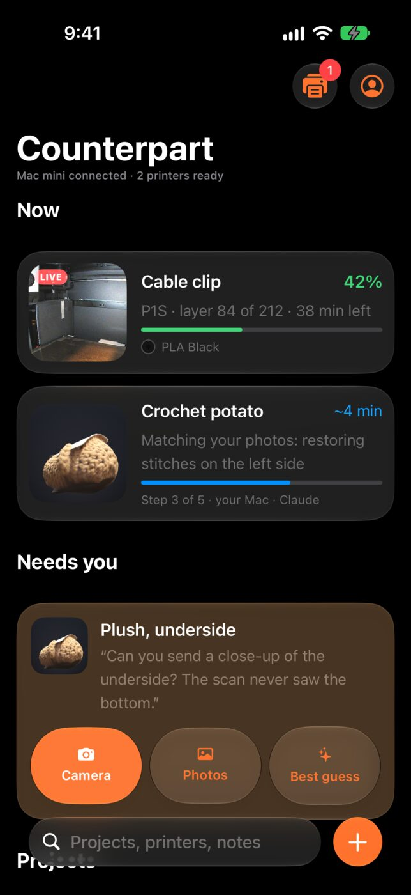 | 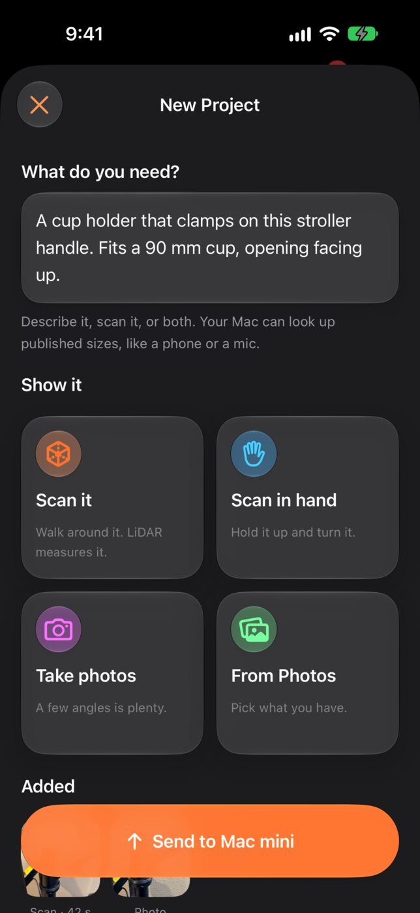 | 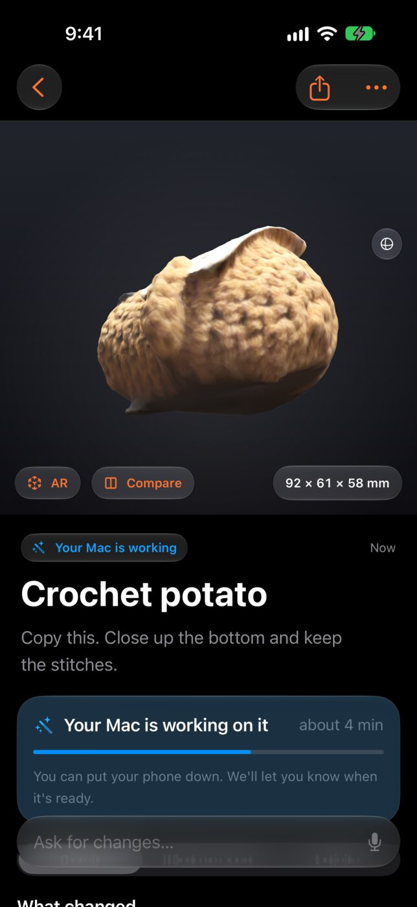 | 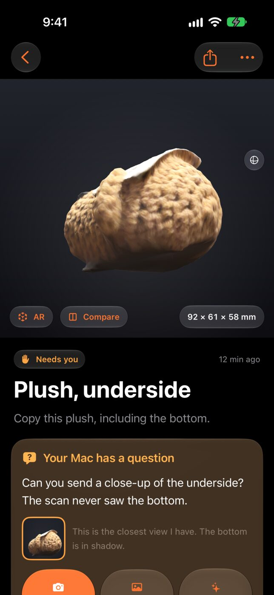 |

| Ready | What you sent | Print | Plate check |
|---|---|---|---|
| 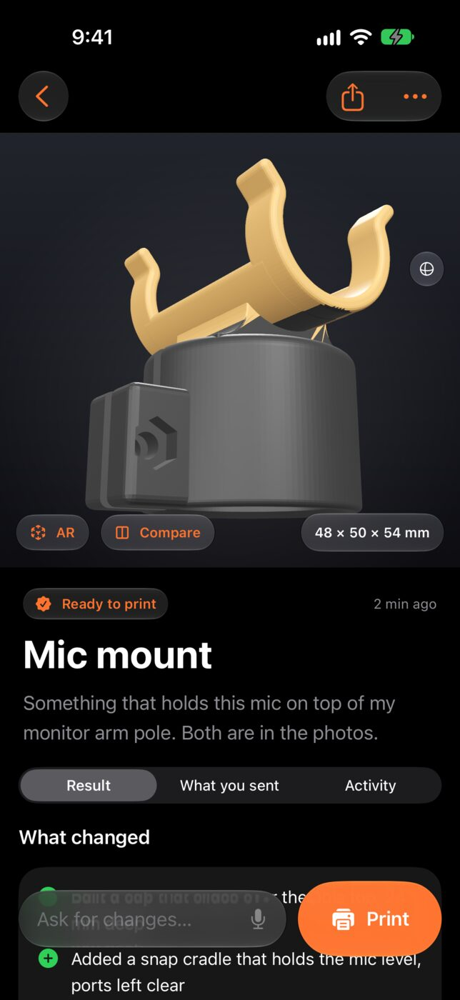 | 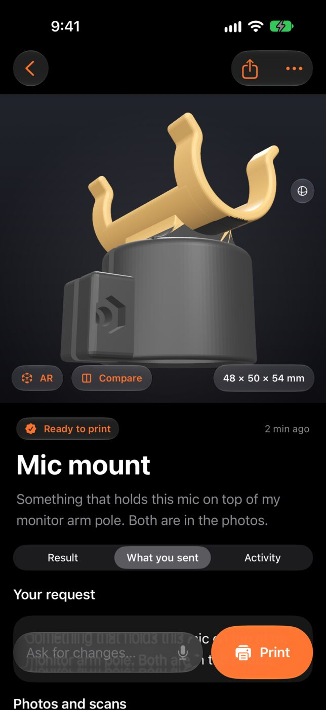 | 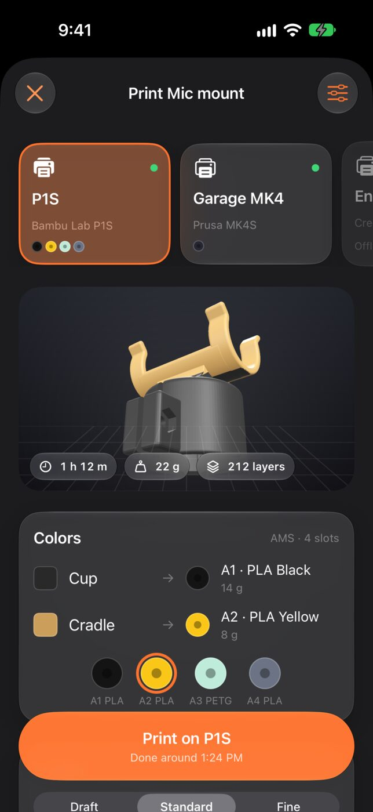 | 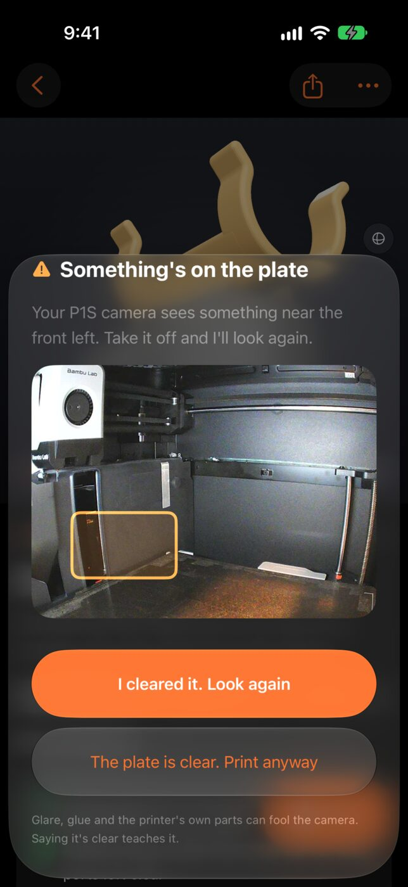 |

| Printing | Lock Screen | Scan in hand | Printers |
|---|---|---|---|
| 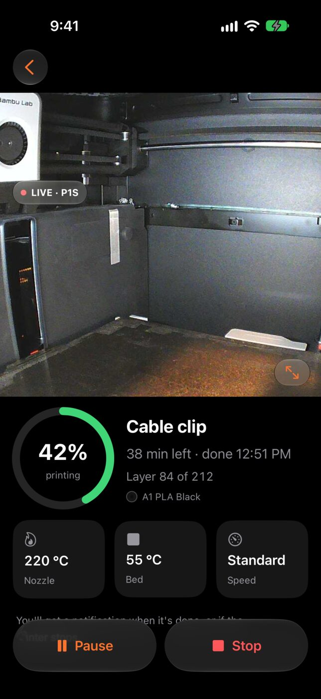 | 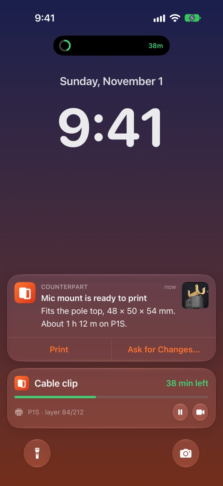 | 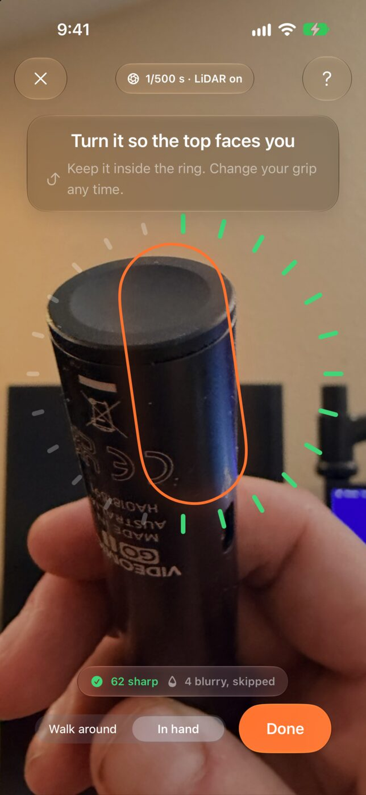 | 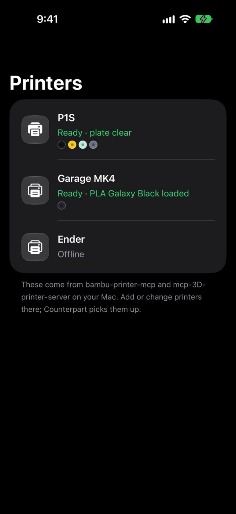 |

## iPad and iPhone Duo

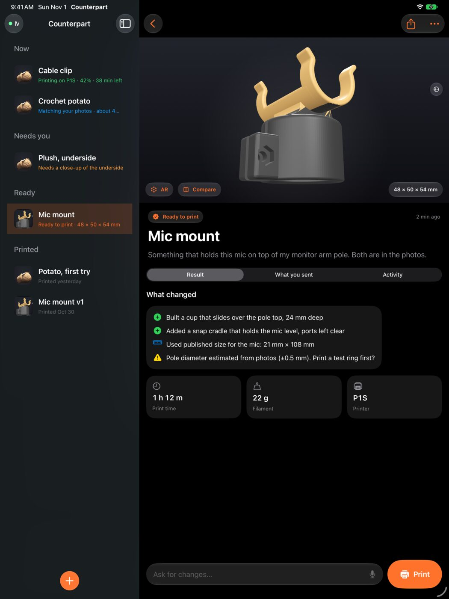

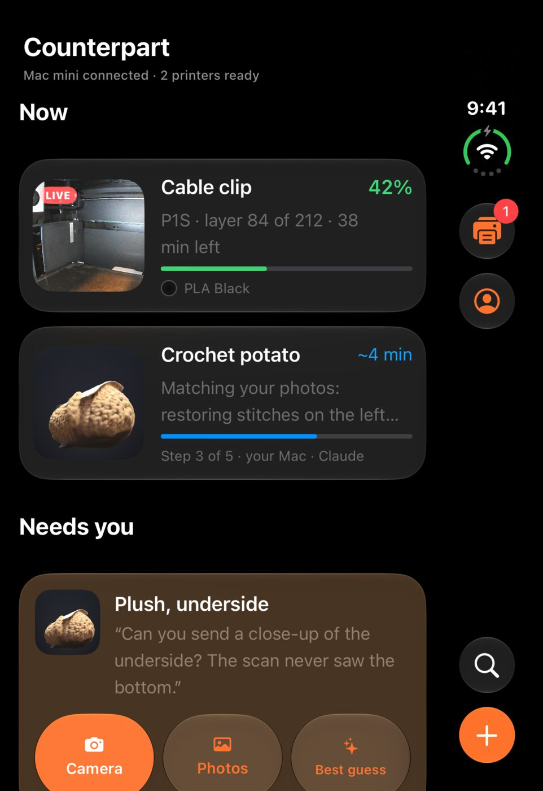

## Mac

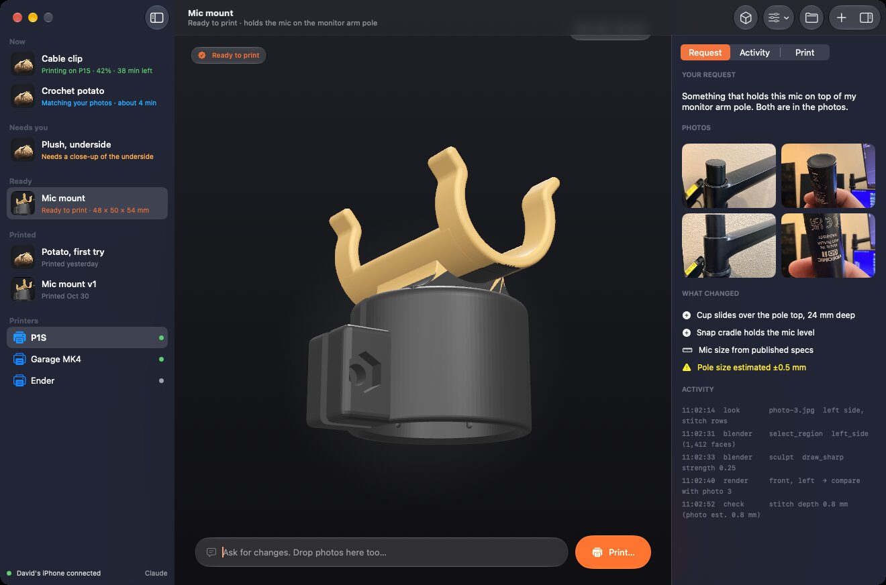

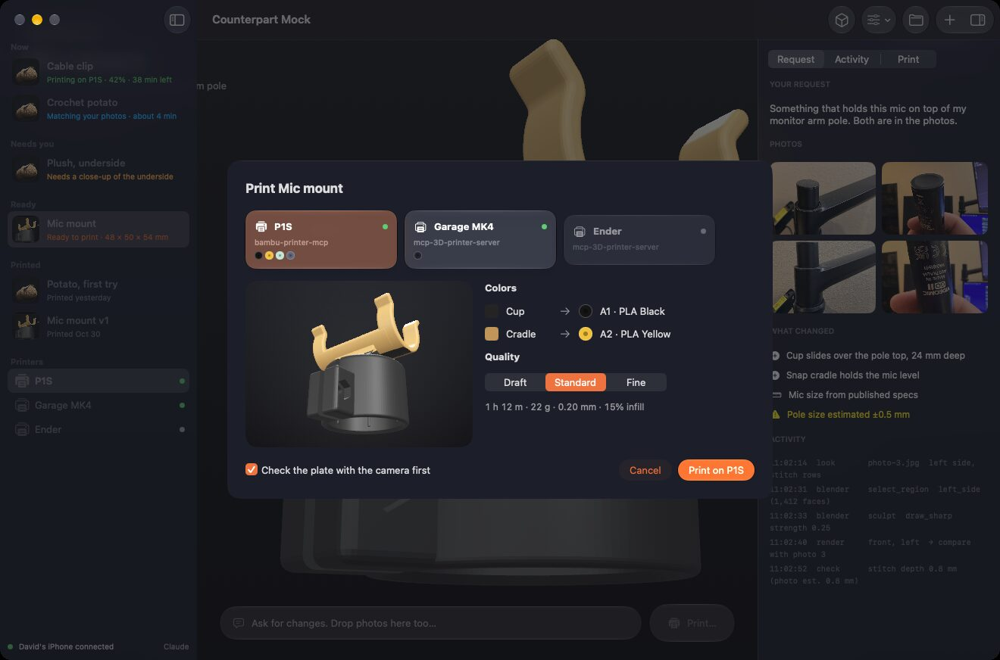

| Menu bar | Settings → Phones |
|---|---|
| 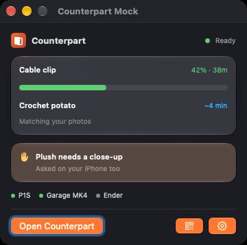 | 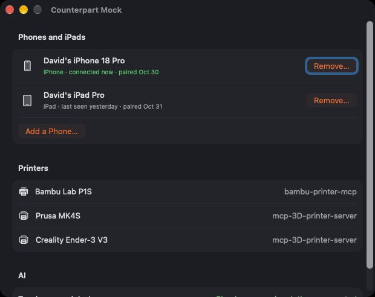 |
