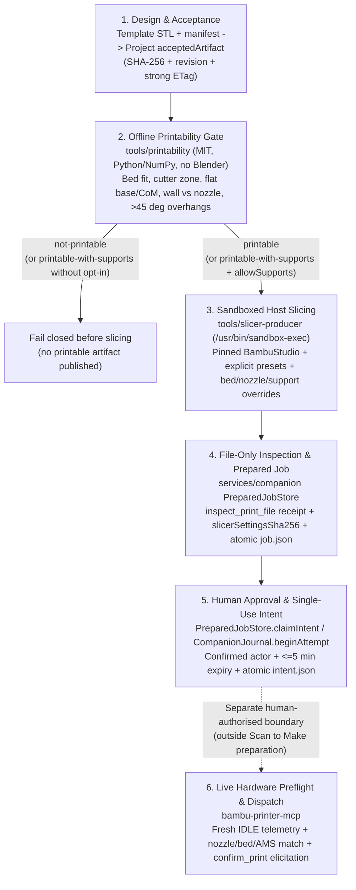

# Print Path: From Fitted Design to Human-Approved Dispatch

This document specifies the end-to-end Scan to Make print path — turning an accepted preview STL from a parametric or scan-derived template into a printability-checked, sandbox-sliced, file-inspected prepared job, and handing off a replay-proof approval intent to a separate human-authorised executor.

**Hard invariant:** Nothing in Scan to Make's template generators, `tools/printability`, `tools/slicer-producer`, or `services/companion` ever contacts a printer, opens a LAN/cloud connection, heats a nozzle or bed, or dispatches G-code. Physical dispatch stays an isolated, human-confirmed step in `bambu-printer-mcp`.

---

## 1. End-to-End Flow



### Offline Dry-Run Entry Point (Available Today)

Before or outside companion project storage, operators and CI/local verification can run Stages 1–3 offline in a single command via [`tools/printability/printability.py`](../tools/printability/printability.py):

```sh
python3 tools/printability/printability.py dry-run \
  --template-dir /path/to/template-output \
  --profile p1s-0.4-hardened \
  --auto-orient \
  --expected-binary-sha256 <64-hex-sha256> \
  --out /path/to/dry-run-output
```

`dry-run` verifies the template manifest's STL digest, optionally rotates the verified watertight mesh to its highest-scoring print orientation when `--auto-orient` is passed (leaving behaviour and output schema unchanged when `--auto-orient` is omitted), analyzes the effective STL bytes against the named Bambu profile, checks the report digest before accepting its verdict, gates slicing on the verdict, invokes [`tools/slicer-producer/producer.py`](../tools/slicer-producer/producer.py) inside `/usr/bin/sandbox-exec`, and atomically writes `source.stl` (always the original template STL), `template-manifest.json`, `printability.json`, `slice/sliced-plate.3mf` (or `--three-mf-name <name>.3mf`, never `*.gcode.3mf`), `slice/plate_1.gcode`, `slice/exported-settings.json`, `slice/manifest.json`, and `dry-run-manifest.json` (`schema: "scan-to-make.print-path-dry-run/0.1.0"`).

### Deterministic Auto-Orientation (`printability orient` & `dry-run --auto-orient`)

[`tools/printability/orient.py`](../tools/printability/orient.py) (MIT, Python stdlib with byte-identical optional NumPy acceleration) evaluates candidate build-plate orientations for a single closed, non-degenerate watertight STL against an explicit printer profile:

```sh
python3 tools/printability/printability.py orient /path/to/part.stl \
  --profile p1s-0.4-hardened \
  --write-stl /path/to/oriented.stl \
  --out /path/to/orientation.json
```

1. **Candidate generation:** Collects downward-pointing outward normals from three geometric sources, collapsing a flat-cluster or convex-hull normal onto an existing candidate only when re-evaluating the rotated mesh proves that the collapsed normal preserves exact build-plate contact facets, stability, bed fit, and support status (never via a fixed angular snap tolerance alone):
   - the **6 axis-aligned faces** (`-Z`, `+Z`, `-X`, `+X`, `-Y`, `+Y`, with identity `-Z` first for tie-breaking),
   - the outward normals of the **largest edge-connected coplanar flat facet clusters**, and
   - the outward normals of the **3D convex-hull faces** (pure-Python Quickhull, capturing multi-pad / multi-rail resting planes whose individual pads are small).
   - When a candidate's footprint fits the build plate and avoids hardware exclusion zones only under a 90° Z yaw (`requiresZRotation90`), the 90° Z rotation is folded directly into the candidate's `3 × 3` `SO(3)` `rotationMatrix`.
2. **Deterministic scoring (`schema: "scan-to-make.print-orientation/0.1.0"`):** Ranks candidates across non-overlapping feasibility tiers (`printable` `[70, 100]` > `printable-with-supports` `[40, 70)` > `unstable-or-missing-flat-base` `[10, 40)` > `exceeds-bed` `[0, 10)`) and continuous quality components combining **bed fit**, **flat base contact area & CoM tipping stability** (matching `analyzer.py`'s gates), **overhang support area**, and **Z height** (print time). Equivalent scores break ties deterministically in favour of the identity orientation (`[0, 0, -1]`, `applied: false`), canonical axis order, and minimal rotation angle.
3. **`dry-run --auto-orient`:** Runs `orient` on the verified `source.stl` bytes **before** the printability gate. When a non-identity rotation wins (`applied: true`), `dry-run` stages `oriented.stl` alongside the untouched `source.stl`, runs `analyze_stl` and BambuStudio slicing against `oriented.stl`, stages the full ranked report at `orientation.json`, and records `orientation` (`applied`, `rotationMatrix`, `axis`, `angleDeg`, `downNormal`, `zYawDeg`, `score`, `baselineScore`, `slicedStlArtifact`, and `reportArtifact`) in `dry-run-manifest.json`. Without `--auto-orient`, `dry-run` neither rotates the STL nor adds `orientation` to `dry-run-manifest.json`.

`dry-run-manifest.json` records `slice/sliced-plate.3mf` (`mediaType: "model/3mf"`) as `slice.printableArtifact` and top-level `dispatchCandidate` (`dispatchCandidate.artifact.sha256`), alongside `slice/plate_1.gcode` (`slice.gcodeArtifact`), after verifying that `Metadata/plate_1.gcode` inside the `.3mf` archive matches `slice/plate_1.gcode` byte-for-byte.

The selected material must match the resolved filament preset’s `filament_type`. A material override such as `--material PETG` also requires a matching `--filament` preset; mismatches fail before slicing. Estimates and the selection descriptor use that same material.

---

## 2. Safety Gates Across Every Stage

Every stage validates the previous stage's cryptographic digest rather than trusting caller labels or mutable paths.

| Stage | Module / Boundary | Safety Gates Enforced | Failure Behaviour |
| --- | --- | --- | --- |
| **1. Template & Project Acceptance** | `tools/templates/**`, `packages/contracts`, `services/project`, `services/companion/src/stl-export.ts` | • Template manifests mark outputs `previewOnly: true` / `provesPhysicalAccuracy: false` and bind `sha256` + `byteLength` in millimetres.<br>• `FileSavedProjectStorage` requires an explicit human-promoted `acceptedArtifact` at a locked `projectRevision` and strong `ETag`.<br>• `readVerifiedStl` reads with `O_RDONLY \| O_NOFOLLOW`, enforces a 32 MiB source cap, rejects non-finite coordinates, zero-area triangles, trailing ASCII payloads, and byte/digest mismatches. | Rejects before any printability or slicer subprocess starts; leaves project state unchanged. |
| **2. Orientation & Printability Analysis** | `tools/printability/orient.py`, `analyzer.py`, `profiles.py`, `profiles.json` | • Requires an explicit printer profile ID (e.g. `p1s-0.4-hardened`); never guesses bed size or nozzle width.<br>• Audits closed 2-manifold directed edges, single connected solid, zero degenerate facets, positive volume, and unit binary-STL normals.<br>• Optional `orient` / `--auto-orient` deterministically scores 6 axis-aligned, flat-cluster, and 3D convex-hull orientations before gating.<br>• Verifies bed X/Y/Z fit and placement outside hardware keep-out zones (such as the P1S/X1C `[0, 18] × [0, 28] mm` front-left filament cutter lever).<br>• Verifies flat base contact area at `zMin`, 2D support convex hull, solid CoM projection inside the hull, and `>= 10°` static tipping angle.<br>• Casts 3D Amanatides–Woo DDA rays along inward 3D normals and XY slice planes to verify opposing wall thickness `>= nozzleDiameterMm` (warning below `2 × nozzleDiameterMm`).<br>• Computes `> 45°` overhang area share and spatial region bounds.<br>• Emits `printerContacted: false`, `dispatchAuthorized: false`, `provesPhysicalFit: false`. | `not-printable` blocks slicing unconditionally. `printable-with-supports` blocks slicing unless `--allow-supports` (or explicit companion support opt-in) is set. Bed fit is checked from the part's extents plus a placement search, because the slicer step arranges the part on the plate (`--arrange 1`); absolute STL coordinates don't matter. |
| **3. Sandboxed Slicing** | `tools/slicer-producer/producer.py`, `services/companion/src/prepared-production.ts` | • `createPreparedProducer` pins `python`, `producer.py` `expectedScriptSha256`, BambuStudio `bundle`, `expectedVersion`, and `expectedBinarySha256`; requests supply STL bytes only.<br>• `producer.py` re-verifies `--expected-input-sha256` and `--expected-input-bytes`, rejects `*.gcode.3mf` output names, resolves bundled preset `inherits` chains into sealed scratch JSON, and applies validated `--bed-type`, `--nozzle-type`, and `--enable-support` overrides before launch.<br>• Launches BambuStudio under `/usr/bin/sandbox-exec` (`(deny network*)`, default-deny `(deny mach-lookup)` with only the three Mach services needed for headless 3MF thumbnail rendering, read-only bundle/input, `~/Library`/`~/.ssh`/`~/.config` denied, `(deny signal)`, writes restricted to private scratch) with a stripped environment (`PATH=/usr/bin:/bin:/usr/sbin:/sbin`, `HOME=<scratch>/home`).<br>• Exports both `plate_1.gcode` and `sliced-plate.3mf` (`--export-3mf`), verifies the `.3mf` archive contains `Metadata/plate_1.gcode` byte-identical to `plate_1.gcode` plus `Metadata/plate_1.json`, `Metadata/slice_info.config`, `[Content_Types].xml`, and `3D/*.model`, and seals all hashes into `slice/manifest.json`. | Non-zero exit, timeout, cancellation, missing/corrupt `.3mf`, G-code mismatch, or digest mismatch reaps the entire slicer process group (`SIGKILL`) and deletes temporary outputs. |
| **4. File-Only Inspection & Job Sealing** | `services/companion/src/prepared-inspection.ts`, `mcp-discovery.ts`, `prepared-jobs.ts` | • Spawns operator-configured `TrustedMcpProcess` in bounded file-only mode, discovers `inspect_print_file` and `print_3mf` schemas, and invokes **only** `inspect_print_file` (`evidence: "file-only"`, `dispatch_authorized: false`).<br>• `compatible()` checks exact `sha256`, `byte_length`, `file_format` (`3mf` vs `gcode`), `plateInternalPath` (`Metadata/plate_1.gcode` for plate `0`), `bambu_model`, `plate_index`, `nozzle_diameters`, `bedType` (`textured_plate` → `"textured pei plate"`, etc.), canonical `materials` at `usedFilamentPositions`, and AMS vs external spool (`254`) consistency.<br>• Validates constructed dispatch arguments against the discovered `print_3mf` schema without calling it.<br>• Re-hashes retained bytes and atomically renames the staging directory into `<jobId>/` (`printable.bin` `0400`, `job.json` `0600`) while holding `projects.withCurrentProject` at the bound revision and `ETag`. | Any project edit during slicing/inspection, schema mismatch, or incompatible 3MF/G-code metadata aborts publication and removes `.staging-*`. |
| **5. Human Approval & Intent Recording** | `PreparedJobStore.claimIntent` (`prepared-jobs.ts`), `CompanionJournal` (`src/index.ts`) | • Requires `confirmed: true`, non-empty human `actorId`, exact `jobSha256` / `planSha256`, and `expiresAtMs` strictly inside `(now, now + 300_000]` (5 minutes), checked **both before and after** re-verifying disk bytes and project state.<br>• Commits `intent.json` via atomic write-then-`link` (`EEXIST` rejects replays across restarts or concurrent processes; torn intents fail closed).<br>• `CompanionJournal` enforces a per-printer filesystem lock (`<printerId>.lock`), single-use `plan.sha256` non-replay, and **unreconciled-attempt blocking**: if a printer has an open `intent` without a human `reconciled` event (`finished`, `cancelled`, or `rejected`), no further attempt can begin. | Expired approval, modified project/artifact, replay attempt, or unreconciled prior job fails closed before any executor is called. |
| **6. Physical Printer Preflight & Dispatch** | `bambu-printer-mcp` (separate repository; never modified or invoked by preparation) | • Requires fresh live printer telemetry (rejects stale/disconnected state) and `gcode_state == IDLE` (or `FINISH` only after explicit bed-clear confirmation; never interrupts, pauses, or clears an active/failed bed).<br>• Re-inspects the exact sliced `.3mf` project and compares file requirements against **live** printer model, installed nozzle diameter, nozzle type (`hardened_steel` vs `stainless_steel`), bed plate compatibility, and live AMS tray materials (`ams_slots` → `ams_mapping`, or external spool `254`).<br>• Requires interactive human confirmation (`confirm_print` / MCP elicitation) immediately prior to upload/start.<br>• Verifies post-start transition rather than blindly retrying uncertain FTPS/MQTT commands. | Any hardware mismatch, busy/stale printer, or declined human confirmation aborts before motion or heating. |

---

## 3. Hardware Baseline & Slicer Metadata Alignment

Read-only inspection of the local `bambu-printer-mcp` configuration and field notes established the primary target hardware profile (`p1s-0.4-hardened` in [`tools/printability/profiles.json`](../tools/printability/profiles.json)):

- **Model:** Bambu Lab P1S (`bambuModel: "p1s"`, build volume `256 × 256 × 250 mm`, front-left filament cutter exclusion zone `[0, 18] × [0, 28] mm`).
- **Hotend:** Single `0.4 mm` **`hardened_steel`** standard-flow nozzle.
- **Build plate:** **Textured PEI Plate** (`bedType: "textured_plate"`).

Closing the loop against real BambuStudio (`02.08.02.61`), `services/companion/src/prepared-inspection.ts`, and `bambu-printer-mcp` surfaced three concrete alignment requirements handled in `tools/slicer-producer` and `tools/printability`:

1. **CLI bed-plate default mismatch:** Bundled BambuStudio process/filament presets omit `curr_bed_type`, causing `BambuStudio --slice 0` to emit `; curr_bed_type = Cool Plate` even when slicing for a Textured PEI Plate. `prepared-inspection.ts` (`compatible()`) compares `actual.bedType` against `beds[selection.bedType]` (`"textured pei plate"`), which fails closed without `--bed-type textured_plate`.
2. **Bundled machine preset nozzle-type default:** `Bambu Lab P1S 0.4 nozzle.json` ships with `"nozzle_type": ["stainless_steel", "stainless_steel"]`. Passing `--nozzle-type hardened_steel` seals `"nozzle_type": ["hardened_steel", "hardened_steel"]` into the flattened machine preset so G-code `; nozzle_type = hardened_steel` matches `bambu-printer-mcp` live nozzle-type preflight.
3. **Sliced `.3mf` project export for AMS dispatch (never `*.gcode.3mf`):**
   - BambuStudio machine start G-code for P1S emits `M620 S0A` (AMS filament selection). `bambu-printer-mcp` (`printRawPrepared`) refuses raw `.gcode` (`upload_file {print:true}` / `start_print_job`) whenever `selectsAms` is true, because raw G-code routes take no `ams_mapping` argument.
   - On P1S, `bambu-printer-mcp` also routes any archive named `*.gcode.3mf` through the legacy `gcode_file` MQTT command (`src/printers/bambu.ts`), which likewise rejects `selectsAms` / `use_ams`. Only a sliced `.3mf` project whose filename ends in `.3mf` and **not** `.gcode.3mf` takes the `project_file` route that sends `use_ams` + `ams_mapping`.
   - Headless `BambuStudio --slice 0 --export-3mf <name>.3mf` renders plate thumbnails via GLFW/Metal, which aborts under blanket Mach denial. `tools/slicer-producer` keeps `(deny mach-lookup)` default-deny alongside unchanged network, filesystem, `~/Library`/`.ssh`/`.config`, and signal denials, and allowlists only the minimal three Mach services required for headless thumbnail rendering (`com.apple.windowserver.active`, `com.apple.coreservices.launchservicesd`, and `xpc-service-name-prefix "com.apple.MTLCompilerService"`). `producer.py` refuses any `*.gcode.3mf` name, exports `sliced-plate.3mf` alongside `plate_1.gcode`, verifies `Metadata/plate_1.gcode` inside the `.3mf` matches `plate_1.gcode` byte-for-byte, and seals its SHA-256 into `slice/manifest.json` (`outputs.threeMf`) and `dry-run-manifest.json` (`dispatchCandidate.artifact.sha256`).

---

## 4. `bambu-printer-mcp` AMS Dispatch Route (`print_3mf` & `ams_slots`)

When a human-authorised executor dispatches a sliced `.3mf` project produced by `tools/slicer-producer` / `printability dry-run` to a P1S with AMS, it **must** use `print_3mf` (never `upload_file {print:true}`, never `start_print_job`, and never a file named `*.gcode.3mf`):

1. **Inspect first (file-only):** Call `inspect_print_file` on the exact `.3mf` path and confirm its `sha256` matches `dispatchCandidate.artifact.sha256` in `dry-run-manifest.json` (and `outputs.threeMf.sha256` in `slice/manifest.json`), `bambu_model == "p1s"`, `plate_index == 0`, `nozzle_diameters == [0.4]`, and `bed_type` matches `"textured pei plate"`.
2. **Read fresh live status:** Call `get_printer_status` (and `get_printer_filaments` / `camera_snapshot` per operator checklist) immediately before dispatch. Confirm the printer is `IDLE` (or `FINISH` only after the plate is confirmed clear), has no blocking HMS errors, reports the expected `0.4 mm` `hardened_steel` nozzle, and identify the loaded filament spool's `ams_unit` (`0..3`) and `slot` (`0..3`) from that **fresh** status.
3. **Compute `ams_slots` (`tray_index` rule):**
   ```text
   tray_index = ams_unit * 4 + slot
   ```
   - `ams_unit` is 0-indexed (`0` for the first AMS unit, `1` for the second, etc.) and `slot` is 0-indexed (`0..3` within that unit).
   - Examples: AMS 0 slot 0 → `0`; AMS 0 slot 1 → `1`; AMS 0 slot 3 → `3`; AMS 1 slot 0 → `4`.
   - One entry is passed per used project filament slot in order (for single-material templates, `[tray_index]`).
   - External spool (non-AMS) jobs instead set `"use_ams": false` and omit `ams_slots` (companion selection represents external spool as `physicalTray: 254`).
4. **Invoke `print_3mf` with human elicitation:**
   ```json
   {
     "three_mf_path": "<absolute path to sliced .3mf (never *.gcode.3mf)>",
     "bambu_model": "p1s",
     "bed_type": "textured_plate",
     "plate_index": 0,
     "use_ams": true,
     "ams_slots": [1]
   }
   ```
   - Leave `bed_leveling`, `flow_calibration`, and `vibration_calibration` at their adapter defaults; `timelapse` stays `false`.
   - The adapter's interactive human confirmation prompt (`confirm_print` elicitation) is mandatory and must be answered by relaying the human operator's explicit confirmation. Setting `BAMBU_REQUIRE_CONFIRMATION=0` is forbidden.

---

## 5. Companion Integration Contract (`services/companion`)

`tools/printability` and `tools/slicer-producer` expose the complete offline analysis, profile-override, and sliced-3MF surface without modifying `services/**` or `packages/**` (`manifest.json` retains `outputs.gcode` and `outputs.exportedSettings` alongside `outputs.threeMf`, and `prepared-inspection.ts` already accepts `mediaType: 'model/3mf'` with `Metadata/plate_1.gcode`). Below is the host-only interface `services/companion` needs to wire `tools/printability`, the `tools/slicer-producer` profile flags, and `outputs.threeMf` into `PreparedJobStore.prepareProduced` and `npm run prepared:produce`.

### 5.1 Extend `PreparedProducerConfiguration` (`services/companion/src/prepared-production.ts` & `prepared-produce-cli.ts`)

Add optional profile hardware overrides to `PreparedProducerConfiguration` and `producerConfigSchema`, and select `manifest.outputs.threeMf` (`mediaType: 'model/3mf'`) as the produced `printable` artifact so AMS-backed `PreparedJob`s dispatch via `print_3mf`:

```ts
export type ProducerBedType = 'textured_plate' | 'cool_plate' | 'engineering_plate' | 'hot_plate';
export type ProducerNozzleType = 'stainless_steel' | 'hardened_steel' | 'tungsten_carbide' | 'brass';

export interface PreparedProducerConfiguration {
  python: string;
  script: string;
  expectedScriptSha256: string;
  bundle: string;
  expectedVersion: string;
  expectedBinarySha256: string;
  machine: string;
  process: string;
  filament: string;
  bedType?: ProducerBedType;
  nozzleType?: ProducerNozzleType;
  enableSupport?: boolean;
  threeMfName?: string; // defaults to "sliced-plate.3mf"; must end in ".3mf" and never ".gcode.3mf"
  timeoutSeconds?: number;
}
```

When present, `createPreparedProducer` appends:
- `--bed-type <config.bedType>`
- `--nozzle-type <config.nozzleType>`
- `--enable-support <effectiveEnableSupport ? '1' : '0'>`
- `--three-mf-name <config.threeMfName>`

`verifyProductionBytes` verifies `manifest.outputs.threeMf` (`mediaType: 'model/3mf'`) in addition to `plate_1.gcode` and `exported-settings.json`, returning the `.3mf` bytes (`mediaType: 'model/3mf'`) so `PreparedJobStore` inspects and seals `printable.bin` for `print_3mf` dispatch. Include these fields in `producer.identity` (`productionHash(JSON.stringify({ adapterVersion: 3, ...config }))`) so changing bed, nozzle, support, or 3MF output configuration changes `producerIdentity` and prevents stale idempotent job reuse.

 Note: `PrintSelectionSchema` allows `'supertack_plate'` for externally sliced 3MFs, but BambuStudio `02.08.02.61` CLI rejects Cool Plate SuperTack (`curr_bed_type` enum `1..4` only), so `ProducerBedType` intentionally excludes `'supertack_plate'`.

### 5.2 Add `PreparedPrintabilityGate` Before Slicing (`services/companion/src/prepared-jobs.ts`)

Configure an operator-pinned printability gate alongside `production` and `inspection` on `PreparedJobStore`:

```ts
export interface PreparedPrintabilityConfiguration {
  python: string;                  // absolute path, invoked with -I -B
  script: string;                  // absolute path to tools/printability/printability.py
  expectedScriptSha256: string;    // 64-hex SHA-256 of printability.py
  expectedAnalyzerSha256: string;  // 64-hex SHA-256 of analyzer.py
  expectedOrientSha256: string;    // 64-hex SHA-256 of orient.py
  expectedProfilesSha256: string;  // 64-hex SHA-256 of profiles.json
  profileId: string;               // e.g. "p1s-0.4-hardened"
  material?: 'PLA' | 'PETG' | 'TPU' | 'ABS' | 'ASA';
  autoOrient?: boolean;            // default false
  timeoutSeconds?: number;         // default 15, max 60
}
```

The CLI explicitly loads sibling modules from its resolved script directory, so `python -I -B tools/printability/printability.py profiles`, `orient`, and `check` work without relying on the working directory or `PYTHONPATH`.

Invocation contract inside `PreparedJobStore.prepareProduced` (after `readVerifiedStl(path, sourceArtifact)` and **before** `producer.produce(...)`):

1. Verify `script`, sibling `analyzer.py`, sibling `orient.py`, and sibling `profiles.json` digests (`O_RDONLY | O_NOFOLLOW`).
2. When `autoOrient` is `true`, spawn `python -I -B <script> orient <source.stl> --profile <profileId> --out <temp/orientation.json> --write-stl <temp/oriented.stl>` first, verify `orientation.input.sha256 === sourceArtifact.sha256`, and feed `<temp/oriented.stl>` (when `orientation.selected.applied === true`) as the effective STL into `check` and `producer.produce(...)`.
3. Spawn `python -I -B <script> check <effective.stl> --profile <profileId> --material <material> --out <temp/printability.json>` with `env: { PATH: '/usr/bin:/bin', LANG: 'C', TMPDIR: temp }` and `stdio: ['ignore', 'pipe', 'pipe']`.
4. Parse `<temp/printability.json>` against a strict Zod schema matching `schema: "scan-to-make.printability/0.1.0"`, verifying:
   - `report.input.sha256` and `report.input.byteLength` match the effective STL (`oriented.stl` when rotated, otherwise `sourceArtifact`);
   - `report.profile.bambuModel === selection.model`;
   - `report.profile.bedType === selection.bedType`;
   - `selection.nozzleDiameters.length === 1 && report.profile.nozzleDiameterMm === selection.nozzleDiameters[0]`;
   - `report.printerContacted === false && report.dispatchAuthorized === false`.
5. Gate on `report.verdict`:
   - `'not-printable'` → throw `PreparedPrintabilityFailure` (surfaces `report.reasonCodes` and `report.reasons`); do **not** invoke BambuStudio and publish no job.
   - `'printable-with-supports'` → reject unless the caller explicitly passed `allowSupports: true` in `prepareProduced` input (`--allow-supports` in `prepared-produce-cli.ts`). When `allowSupports === true`, pass `enableSupport: true` into `producer.produce(effectiveSource, { enableSupport: true }, signal)`.
   - `'printable'` → proceed with `enableSupport: false` (unless overridden).
6. Retain `printability.json` (`0400`, plus `orientation.json` / `oriented.stl` when `autoOrient` is enabled) inside `<jobId>/` and extend `PreparedProductionSchema` (`services/companion/src/prepared-production.ts`) with:

```ts
printability: z.strictObject({
  profileId: z.string().min(1).max(128),
  verdict: z.enum(['printable', 'printable-with-supports']),
  allowSupports: z.boolean(),
  reportArtifact: ArtifactRefSchema,
}),
```

### 5.3 Optional Nozzle-Type Cross-Check in `prepared-inspection.ts`

`inspect_print_file` already returns `inspection.nozzleTypes?: string[]` in its v1 file-only receipt, and `PreparedInspectionSchema` already parses it. When `PreparedProducerConfiguration.nozzleType` is set (or if `PrintSelectionSchema` adds an optional `nozzleTypes?: ('stainless_steel' | 'hardened_steel' | 'tungsten_carbide' | 'brass')[]`), `compatible()` in `services/companion/src/prepared-inspection.ts` should verify `actual.nozzleTypes?.[0] === expectedNozzleType` so a mismatch between declared hotend metallurgy and sliced G-code fails at preparation time rather than waiting for live printer preflight.
