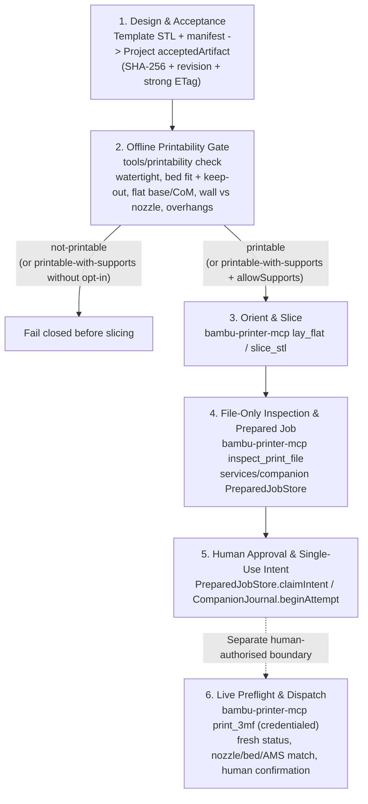

# Print Path: From Fitted Design to Human-Approved Dispatch

This document describes how Scan to Make turns an accepted preview STL into a sliced, file-inspected prepared job and hands a replay-proof approval intent to a separate, human-authorised executor.

**Use bambu-printer-mcp for every printer, slicer and mesh-edit step.** Its `slice_stl`, `lay_flat`, `inspect_print_file` and `print_3mf` already do this work, with the safety gates in its `src/safety/`. Scan to Make does not reimplement them; see "Read bambu-printer-mcp before you build" in [AGENTS.md](../AGENTS.md). An earlier version of this path had its own BambuStudio wrapper (`tools/slicer-producer`) and a printability `dry-run` slicer. Both duplicated `slice_stl`. The dry-run slicer has been removed, and `tools/slicer-producer` is removed with the companion re-route (#97).

**Hard invariant:** preparation never contacts a printer, opens a LAN or cloud printer connection, heats a nozzle or bed, or dispatches a job. Preparation may call bambu-printer-mcp's file-only tools (`slice_stl`, `lay_flat`, `inspect_print_file`), but only in a separate process whose environment has no `PRINTER_HOST`, `BAMBU_SERIAL` or `BAMBU_TOKEN`, through an allowlist of those tools. Physical dispatch is a separate, human-confirmed step that uses a credentialed bambu-printer-mcp process.

---

## 1. End-to-End Flow

---

## 2. Stages and Their Gates

| Stage | Module | Gates | On failure |
| --- | --- | --- | --- |
| **1. Template & project acceptance** | `tools/templates/**`, `packages/contracts`, `services/project`, `services/companion/src/stl-export.ts` | Template manifests mark outputs `previewOnly: true` / `provesPhysicalAccuracy: false` and bind `sha256` + `byteLength` in millimetres. `FileSavedProjectStorage` requires a human-promoted `acceptedArtifact` at a locked `projectRevision` and strong `ETag`. `readVerifiedStl` opens with `O_RDONLY \| O_NOFOLLOW`, caps sources at 32 MiB and rejects non-finite coordinates, zero-area triangles, trailing ASCII payloads and digest mismatches. | Rejects before printability or slicing starts; project state is unchanged. |
| **2. Printability analysis** | `tools/printability` (`check`) | Explicit printer profile (e.g. `p1s-0.4-hardened`); closed 2-manifold audit, positive volume, finite normals; bed fit plus keep-out zones (P1S cutter lever `[0, 18] × [0, 28] mm`); flat base, CoM inside the support hull, `>= 10°` tipping angle; wall thickness vs nozzle; `> 45°` overhang area. Reports `dispatchAuthorized: false`, `provesPhysicalFit: false`. These mesh checks are not in bambu-printer-mcp. | `not-printable` blocks slicing. `printable-with-supports` blocks slicing unless supports are explicitly allowed. |
| **3. Orient & slice** | bambu-printer-mcp `lay_flat` and `slice_stl`, called by `services/companion` (re-route in #97) | Credential-free bambu-printer-mcp process and tool allowlist (see the invariant). `slice_stl` takes the explicit `bambu_model`, `nozzle_diameter`, `bed_type` and `nozzle_type`, and resolves the exact machine preset itself; it exports a sliced 3MF. Its `orient` and `arrange` options replace any local orientation code. | Slicer errors come back from `slice_stl` with its own reason; nothing is published. |
| **4. File-only inspection & job sealing** | `services/companion/src/prepared-inspection.ts`, `mcp-discovery.ts`, `prepared-jobs.ts` | Runs the trusted bambu-printer-mcp process in file-only mode and calls only `inspect_print_file` (`evidence: "file-only"`, `dispatch_authorized: false`). `compatible()` checks exact `sha256`, `byte_length`, `file_format`, `plateInternalPath`, `bambu_model`, `plate_index`, `nozzle_diameters`, `bedType`, materials at `usedFilamentPositions`, and AMS vs external spool (`254`). Dispatch arguments are validated against the discovered `print_3mf` schema without calling it. Bytes are re-hashed and the job is published atomically at the bound revision and `ETag`. | A project edit, schema mismatch or incompatible file aborts publication. |
| **5. Human approval & intent** | `PreparedJobStore.claimIntent`, `CompanionJournal` | Requires `confirmed: true`, a human `actorId`, exact `jobSha256` / `planSha256` and an expiry within 5 minutes, checked before and after re-verifying bytes and project state. `intent.json` is written with write-then-`link`, so replays fail. A per-printer lock and unreconciled-attempt blocking prevent a second attempt until the first is reconciled. | Expired approval, changed artifact, replay or unreconciled prior job fails closed. |
| **6. Live preflight & dispatch** | bambu-printer-mcp `print_3mf` (credentialed process, human-authorised) | Fresh live status (`IDLE`, or `FINISH` only after bed-clear confirmation), no blocking HMS errors, re-inspection of the exact file against live model, nozzle diameter and type, plate and AMS trays, then the adapter's own human confirmation. | Any mismatch, busy or stale printer, or declined confirmation aborts before motion or heating. |

---

## 3. Hardware Baseline (David's printer)

- **Model:** Bambu Lab P1S (`bambu_model: "p1s"`, `256 × 256 × 250 mm`, cutter keep-out `[0, 18] × [0, 28] mm`).
- **Hotend:** single 0.4 mm `hardened_steel` standard-flow nozzle. Pass `nozzle_type: "hardened_steel"` (or `BAMBU_NOZZLE_TYPE=hardened_steel`) to `slice_stl`. The stock P1S preset says `stainless_steel`, and the printer's nozzle check rejects a mismatch.
- **Plate:** Textured PEI (`bed_type: "textured_plate"`).
- **File name:** dispatch a sliced `.3mf` project, never a file named `*.gcode.3mf`. On P1S that suffix takes the legacy `gcode_file` route, which refuses AMS jobs.

---

## 4. Dispatch (`print_3mf`)

1. **Inspect first:** `inspect_print_file` on the exact `.3mf`, matching the prepared job's `sha256`, `bambu_model`, `plate_index`, `nozzle_diameters` and `bed_type`.
2. **Fresh status:** `get_printer_status`, `get_printer_filaments` and `camera_snapshot` immediately before dispatch. Read the loaded spool's AMS unit and slot from that fresh status.
3. **AMS slot:** `tray_index = ams_unit * 4 + slot` (AMS 0 slot 3 → `3`). External spool jobs set `use_ams: false`.
4. **Route:**
   - Bambu firmware 01.08.05 and later rejects unsigned third-party LAN print commands (HMS `0500-0500-0001-0007`) unless LAN Only Mode and Developer Mode are on.
   - The FULU bridge (`connection_mode: "bambu_network"`, `connection_type: "lan"`) sends commands signed by Bambu's own plug-in and prints without Developer Mode. It printed on David's P1S on 2026-10-25.
   - The harness is described in bambu-printer-mcp's `docs/FULU.md` and its agent memory.
   - Other routes, per the PRD (§9.2): direct LAN with Developer Mode, a Bambu Connect hand-off (`bambu_connect`), or export to SD card.
5. **Confirm:** the adapter's human confirmation prompt is mandatory. Never set `BAMBU_REQUIRE_CONFIRMATION=0`.

---

## 5. Companion Contract (`services/companion`)

- The companion already spawns a trusted bambu-printer-mcp process (`TrustedMcpProcess`) for `inspect_print_file`.
- Slicing and orientation use that same pattern (#97): a separate bambu-printer-mcp process with an explicit environment that omits printer credentials, and a tool allowlist of `slice_stl`, `lay_flat` and `inspect_print_file`. Any other tool fails closed.
- `tools/printability check` stays as the pre-slice gate, run before `slice_stl`.
