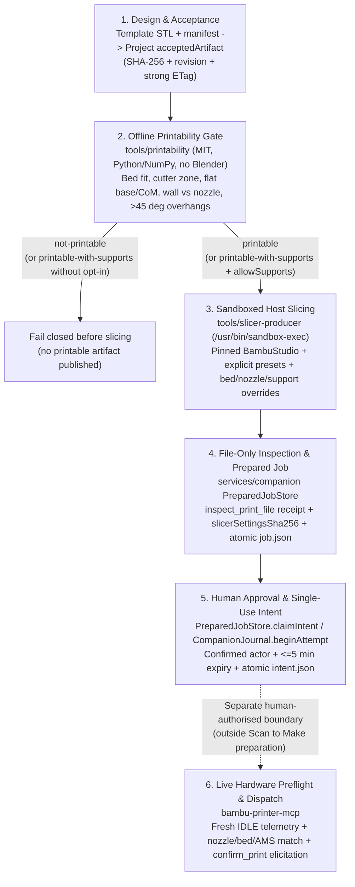

# Print Path: From Fitted Design to Human-Approved Dispatch

This document specifies the end-to-end Scan to Make print path — turning an accepted preview STL from a parametric or scan-derived template into a printability-checked, sandbox-sliced, file-inspected prepared job, and handing off a replay-proof approval intent to a separate human-authorised executor.

**Hard invariant:** Nothing in Scan to Make's template generators, `tools/printability`, `tools/slicer-producer`, or `services/companion` ever contacts a printer, opens a LAN/cloud connection, heats a nozzle or bed, or dispatches G-code. Physical dispatch stays an isolated, human-confirmed step in `bambu-printer-mcp`.

---

## 1. End-to-End Flow



### Offline Dry-Run Entry Point (Available Today)

Before or outside companion project storage, operators and CI/local verification can run Stages 1–3 offline in a single command via [`tools/printability/printability.py`](../tools/printability/printability.py):

```sh
python3 tools/printability/printability.py dry-run \
  --template-dir /path/to/template-output \
  --profile p1s-0.4-hardened \
  --expected-binary-sha256 <64-hex-sha256> \
  --out /path/to/dry-run-output
```

`dry-run` verifies the template manifest's STL digest, analyzes the retained verified bytes against the named Bambu profile, checks the report digest before accepting its verdict, gates slicing on the verdict, invokes [`tools/slicer-producer/producer.py`](../tools/slicer-producer/producer.py) inside `/usr/bin/sandbox-exec`, and atomically writes `source.stl`, `template-manifest.json`, `printability.json`, `slice/plate_1.gcode`, `slice/exported-settings.json`, `slice/manifest.json`, and `dry-run-manifest.json` (`schema: "scan-to-make.print-path-dry-run/0.1.0"`).

The selected material must match the resolved filament preset’s `filament_type`. A material override such as `--material PETG` also requires a matching `--filament` preset; mismatches fail before slicing. Estimates and the selection descriptor use that same material.

---

## 2. Safety Gates Across Every Stage

Every stage validates the previous stage's cryptographic digest rather than trusting caller labels or mutable paths.

| Stage | Module / Boundary | Safety Gates Enforced | Failure Behaviour |
| --- | --- | --- | --- |
| **1. Template & Project Acceptance** | `tools/templates/**`, `packages/contracts`, `services/project`, `services/companion/src/stl-export.ts` | • Template manifests mark outputs `previewOnly: true` / `provesPhysicalAccuracy: false` and bind `sha256` + `byteLength` in millimetres.<br>• `FileSavedProjectStorage` requires an explicit human-promoted `acceptedArtifact` at a locked `projectRevision` and strong `ETag`.<br>• `readVerifiedStl` reads with `O_RDONLY \| O_NOFOLLOW`, enforces a 32 MiB source cap, rejects non-finite coordinates, zero-area triangles, trailing ASCII payloads, and byte/digest mismatches. | Rejects before any printability or slicer subprocess starts; leaves project state unchanged. |
| **2. Printability Analysis** | `tools/printability/analyzer.py`, `profiles.py`, `profiles.json` | • Requires an explicit printer profile ID (e.g. `p1s-0.4-hardened`); never guesses bed size or nozzle width.<br>• Audits closed 2-manifold directed edges, positive volume, and finite normals.<br>• Verifies bed X/Y/Z fit and placement outside hardware keep-out zones (such as the P1S/X1C `[0, 18] × [0, 28] mm` front-left filament cutter lever).<br>• Verifies flat base contact area at `zMin`, 2D support convex hull, solid CoM projection inside the hull, and `>= 10°` static tipping angle.<br>• Casts 3D Amanatides–Woo DDA rays along inward 3D normals and XY slice planes to verify opposing wall thickness `>= nozzleDiameterMm` (warning below `2 × nozzleDiameterMm`).<br>• Computes `> 45°` overhang area share and spatial region bounds.<br>• Emits `printerContacted: false`, `dispatchAuthorized: false`, `provesPhysicalFit: false`. | `not-printable` blocks slicing unconditionally. `printable-with-supports` blocks slicing unless `--allow-supports` (or explicit companion support opt-in) is set. Bed fit is checked from the part's extents plus a placement search, because the slicer step arranges the part on the plate (`--arrange 1`); absolute STL coordinates don't matter. |
| **3. Sandboxed Slicing** | `tools/slicer-producer/producer.py`, `services/companion/src/prepared-production.ts` | • `createPreparedProducer` pins `python`, `producer.py` `expectedScriptSha256`, BambuStudio `bundle`, `expectedVersion`, and `expectedBinarySha256`; requests supply STL bytes only.<br>• `producer.py` re-verifies `--expected-input-sha256` and `--expected-input-bytes`, resolves bundled preset `inherits` chains into sealed scratch JSON, and applies validated `--bed-type`, `--nozzle-type`, and `--enable-support` overrides before launch.<br>• Launches BambuStudio under `/usr/bin/sandbox-exec` (`(deny network*)`, `(deny mach-lookup)`, read-only bundle/input, writes restricted to private scratch) with a stripped environment (`PATH=/usr/bin:/bin`, `HOME=<scratch>/home`) and FD-3 process-group ownership tracking.<br>• `verifyProductionBytes` checks `plate_1.gcode` and `exported-settings.json` hashes against `slice/manifest.json` and binds `selection.slicerSettingsSha256 = sha256(exported-settings.json)`. | Non-zero exit, timeout, cancellation, missing G-code/settings, or digest mismatch reaps the entire slicer process group (`SIGKILL`) and deletes temporary outputs. |
| **4. File-Only Inspection & Job Sealing** | `services/companion/src/prepared-inspection.ts`, `mcp-discovery.ts`, `prepared-jobs.ts` | • Spawns operator-configured `TrustedMcpProcess` in bounded file-only mode, discovers `inspect_print_file` and `print_3mf` schemas, and invokes **only** `inspect_print_file` (`evidence: "file-only"`, `dispatch_authorized: false`).<br>• `compatible()` checks exact `sha256`, `byte_length`, `file_format` (`3mf` vs `gcode`), `bambu_model`, `plate_index` (`0` for G-code), `nozzle_diameters`, `bedType` (`textured_plate` → `"textured pei plate"`, etc.), canonical `materials` at `usedFilamentPositions`, and AMS vs external spool (`254`) consistency.<br>• Validates constructed dispatch arguments against the discovered `print_3mf` schema without calling it.<br>• Re-hashes retained bytes and atomically renames the staging directory into `<jobId>/` (`printable.bin` `0400`, `job.json` `0600`) while holding `projects.withCurrentProject` at the bound revision and `ETag`. | Any project edit during slicing/inspection, schema mismatch, or incompatible G-code header aborts publication and removes `.staging-*`. |
| **5. Human Approval & Intent Recording** | `PreparedJobStore.claimIntent` (`prepared-jobs.ts`), `CompanionJournal` (`src/index.ts`) | • Requires `confirmed: true`, non-empty human `actorId`, exact `jobSha256` / `planSha256`, and `expiresAtMs` strictly inside `(now, now + 300_000]` (5 minutes), checked **both before and after** re-verifying disk bytes and project state.<br>• Commits `intent.json` via atomic write-then-`link` (`EEXIST` rejects replays across restarts or concurrent processes; torn intents fail closed).<br>• `CompanionJournal` enforces a per-printer filesystem lock (`<printerId>.lock`), single-use `plan.sha256` non-replay, and **unreconciled-attempt blocking**: if a printer has an open `intent` without a human `reconciled` event (`finished`, `cancelled`, or `rejected`), no further attempt can begin. | Expired approval, modified project/artifact, replay attempt, or unreconciled prior job fails closed before any executor is called. |
| **6. Physical Printer Preflight & Dispatch** | `bambu-printer-mcp` (separate repository; never modified or invoked by preparation) | • Requires fresh live printer telemetry (rejects stale/disconnected state) and `gcode_state == IDLE` (never interrupts, pauses, or clears an active/failed bed).<br>• Re-inspects the exact printable artifact and compares file requirements against **live** printer model, installed nozzle diameter, nozzle type (`hardened_steel` vs `stainless_steel`), bed plate compatibility, and live AMS tray materials (`ams_mapping` or external spool `254`).<br>• Requires interactive human confirmation (`confirm_print` / MCP elicitation) immediately prior to upload/start.<br>• Verifies post-start transition rather than blindly retrying uncertain FTPS/MQTT commands. | Any hardware mismatch, busy/stale printer, or declined human confirmation aborts before motion or heating. |

---

## 3. Hardware Baseline & Slicer Metadata Alignment

Read-only inspection of the local `bambu-printer-mcp` configuration and field notes established the primary target hardware profile (`p1s-0.4-hardened` in [`tools/printability/profiles.json`](../tools/printability/profiles.json)):

- **Model:** Bambu Lab P1S (`bambuModel: "p1s"`, build volume `256 × 256 × 250 mm`, front-left filament cutter exclusion zone `[0, 18] × [0, 28] mm`).
- **Hotend:** Single `0.4 mm` **`hardened_steel`** standard-flow nozzle.
- **Build plate:** **Textured PEI Plate** (`bedType: "textured_plate"`).

Closing the loop against real BambuStudio (`02.08.02.61`) and `services/companion/src/prepared-inspection.ts` surfaced three concrete metadata alignment requirements now handled in `tools/slicer-producer` and `tools/printability`:

1. **CLI bed-plate default mismatch:** Bundled BambuStudio process/filament presets omit `curr_bed_type`, causing `BambuStudio --slice 0` to emit `; curr_bed_type = Cool Plate` even when slicing for a Textured PEI Plate. `prepared-inspection.ts` (`compatible()`) compares `actual.bedType` against `beds[selection.bedType]` (`"textured pei plate"`), which fails closed without `--bed-type textured_plate`.
2. **Bundled machine preset nozzle-type default:** `Bambu Lab P1S 0.4 nozzle.json` ships with `"nozzle_type": ["stainless_steel", "stainless_steel"]`. Passing `--nozzle-type hardened_steel` seals `"nozzle_type": ["hardened_steel", "hardened_steel"]` into the flattened machine preset so G-code `; nozzle_type = hardened_steel` matches `bambu-printer-mcp` live nozzle-type preflight.
3. **G-code vs 3MF in Seatbelt isolation:** BambuStudio `--export-3mf` requires OpenGL/WindowServer thumbnail rendering that macOS seatbelt isolation (`(deny mach-lookup)`) intentionally blocks. `tools/slicer-producer` therefore produces `plate_1.gcode` (`text/x.gcode`, `plateIndex: 0`) plus `exported-settings.json`, which `PreparedJobStore` and `inspect_print_file` natively inspect and seal.

---

## 4. Companion Integration Contract (`services/companion`)

`tools/printability` and `tools/slicer-producer` expose the complete offline analysis and profile-override surface without modifying `services/**` or `packages/**`. Below is the host-only interface `services/companion` needs to wire `tools/printability` and the new `tools/slicer-producer` profile flags into `PreparedJobStore.prepareProduced` and `npm run prepared:produce`.

### 4.1 Extend `PreparedProducerConfiguration` (`services/companion/src/prepared-production.ts` & `prepared-produce-cli.ts`)

Add optional profile hardware overrides to `PreparedProducerConfiguration` and `producerConfigSchema` so operator producer configs targeting `textured_plate` / `hardened_steel` pass `inspect_print_file`:

```ts
export type ProducerBedType = 'textured_plate' | 'cool_plate' | 'engineering_plate' | 'hot_plate';
export type ProducerNozzleType = 'stainless_steel' | 'hardened_steel' | 'tungsten_carbide' | 'brass';

export interface PreparedProducerConfiguration {
  python: string;
  script: string;
  expectedScriptSha256: string;
  bundle: string;
  expectedVersion: string;
  expectedBinarySha256: string;
  machine: string;
  process: string;
  filament: string;
  bedType?: ProducerBedType;
  nozzleType?: ProducerNozzleType;
  enableSupport?: boolean;
  timeoutSeconds?: number;
}
```

When present, `createPreparedProducer` appends:
- `--bed-type <config.bedType>`
- `--nozzle-type <config.nozzleType>`
- `--enable-support <effectiveEnableSupport ? '1' : '0'>`

Include these fields in `producer.identity` (`productionHash(JSON.stringify({ adapterVersion: 2, ...config }))`) so changing bed, nozzle, or support configuration changes `producerIdentity` and prevents stale idempotent job reuse.

 Note: `PrintSelectionSchema` allows `'supertack_plate'` for externally sliced 3MFs, but BambuStudio `02.08.02.61` CLI rejects Cool Plate SuperTack (`curr_bed_type` enum `1..4` only), so `ProducerBedType` intentionally excludes `'supertack_plate'`.

### 4.2 Add `PreparedPrintabilityGate` Before Slicing (`services/companion/src/prepared-jobs.ts`)

Configure an operator-pinned printability gate alongside `production` and `inspection` on `PreparedJobStore`:

```ts
export interface PreparedPrintabilityConfiguration {
  python: string;                  // absolute path, invoked with -I -B
  script: string;                  // absolute path to tools/printability/printability.py
  expectedScriptSha256: string;    // 64-hex SHA-256 of printability.py
  expectedAnalyzerSha256: string;  // 64-hex SHA-256 of analyzer.py
  expectedProfilesSha256: string;  // 64-hex SHA-256 of profiles.json
  profileId: string;               // e.g. "p1s-0.4-hardened"
  material?: 'PLA' | 'PETG' | 'TPU' | 'ABS' | 'ASA';
  timeoutSeconds?: number;         // default 15, max 60
}
```

The CLI explicitly loads sibling modules from its resolved script directory, so both `python -I -B tools/printability/printability.py profiles` and the isolated `check` invocation below work without relying on the working directory or `PYTHONPATH`.

Invocation contract inside `PreparedJobStore.prepareProduced` (after `readVerifiedStl(path, sourceArtifact)` and **before** `producer.produce(...)`):

1. Verify `script`, sibling `analyzer.py`, and sibling `profiles.json` digests (`O_RDONLY | O_NOFOLLOW`).
2. Spawn `python -I -B <script> check <source.stl> --profile <profileId> --material <material> --out <temp/printability.json>` with `env: { PATH: '/usr/bin:/bin', LANG: 'C', TMPDIR: temp }` and `stdio: ['ignore', 'pipe', 'pipe']`.
3. Parse `<temp/printability.json>` against a strict Zod schema matching `schema: "scan-to-make.printability/0.1.0"`, verifying:
   - `report.input.sha256 === sourceArtifact.sha256` and `report.input.byteLength === sourceArtifact.byteLength`;
   - `report.profile.bambuModel === selection.model`;
   - `report.profile.bedType === selection.bedType`;
   - `selection.nozzleDiameters.length === 1 && report.profile.nozzleDiameterMm === selection.nozzleDiameters[0]`;
   - `report.printerContacted === false && report.dispatchAuthorized === false`.
4. Gate on `report.verdict`:
   - `'not-printable'` → throw `PreparedPrintabilityFailure` (surfaces `report.reasonCodes` and `report.reasons`); do **not** invoke BambuStudio and publish no job.
   - `'printable-with-supports'` → reject unless the caller explicitly passed `allowSupports: true` in `prepareProduced` input (`--allow-supports` in `prepared-produce-cli.ts`). When `allowSupports === true`, pass `enableSupport: true` into `producer.produce(source, { enableSupport: true }, signal)`.
   - `'printable'` → proceed with `enableSupport: false` (unless overridden).
5. Retain `printability.json` (`0400`) inside `<jobId>/printability.json` and extend `PreparedProductionSchema` (`services/companion/src/prepared-production.ts`) with:

```ts
printability: z.strictObject({
  profileId: z.string().min(1).max(128),
  verdict: z.enum(['printable', 'printable-with-supports']),
  allowSupports: z.boolean(),
  reportArtifact: ArtifactRefSchema,
}),
```

### 4.3 Optional Nozzle-Type Cross-Check in `prepared-inspection.ts`

`inspect_print_file` already returns `inspection.nozzleTypes?: string[]` in its v1 file-only receipt, and `PreparedInspectionSchema` already parses it. When `PreparedProducerConfiguration.nozzleType` is set (or if `PrintSelectionSchema` adds an optional `nozzleTypes?: ('stainless_steel' | 'hardened_steel' | 'tungsten_carbide' | 'brass')[]`), `compatible()` in `services/companion/src/prepared-inspection.ts` should verify `actual.nozzleTypes?.[0] === expectedNozzleType` so a mismatch between declared hotend metallurgy and sliced G-code fails at preparation time rather than waiting for live printer preflight.
